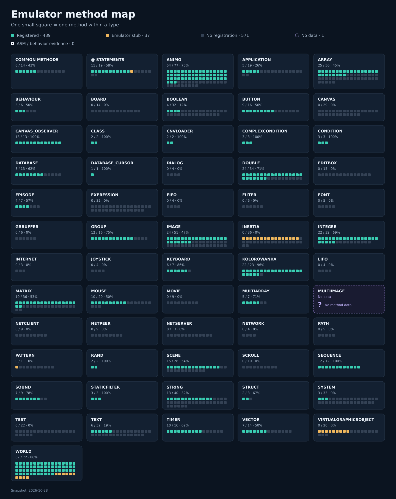

# Rex-EMoolator

[Polski](README.pl.md) | **English**

[](https://github.com/patryk025/Rex-EMoolator/releases/latest)
[](https://patryk025.github.io/Rex-EMoolator/en/)
[](LICENSE)

An open-source emulator that recreates the behavior of the Piklib/BlooMoo engine used in Aidem Media games. It runs on Windows, Linux, macOS, and Android. Games are not included: you need your own copy.

<table>
<tr>
<td width="33%"></td>
<td width="33%"></td>
<td width="33%"></td>
</tr>
</table>

More in the [screenshot gallery](https://patryk025.github.io/Rex-EMoolator/en/emulator/screenshots/).

## Getting started

1. Download the package for your system from the [latest release](https://github.com/patryk025/Rex-EMoolator/releases/latest).

   | System | File | Needs Java |
   |---|---|---|
   | Windows | `.exe` installer | no |
   | macOS | `.dmg` image | no |
   | Linux | `.deb` package | no |
   | Android 7.0+ | `.apk` | no |
   | Any | `.jar` or `.zip` | Java 21+ |

2. Start the emulator and click **Add game**.
3. Point it at the game folder, a disc image, or a ZIP archive, then save.
4. Click **Run game**.

The [emulator guide](https://patryk025.github.io/Rex-EMoolator/en/emulator/) covers per-game settings, keyboard shortcuts, and where saves are kept. Official and fan-made fixes can be installed from the [patch manager](https://patryk025.github.io/Rex-EMoolator/en/emulator/patches/).

## Game status

| Game | Status | Tracking |
|---|---|---|
| Reksio i Skarb Piratów |  | [Project](https://github.com/users/patryk025/projects/3) |
| Reksio i UFO |  | [Project](https://github.com/users/patryk025/projects/4) |
| Reksio i Czarodzieje |  | [Project](https://github.com/users/patryk025/projects/6) |
| Reksio i Wehikuł Czasu |  | [Project](https://github.com/users/patryk025/projects/8) |
| Reksio i Kapitan Nemo |  | [Project](https://github.com/users/patryk025/projects/10) |
| Reksio i Kretes w Akcji! |  | [Project](https://github.com/users/patryk025/projects/11) |
| Poznaj Mity: Wyprawa po Złote Runo |  | [Project](https://github.com/users/patryk025/projects/12) |
| Poznaj Mity: Wojna Trojańska |  | [Project](https://github.com/users/patryk025/projects/13) |
| Poznaj Mity: Przygody Odyseusza |  | [Project](https://github.com/users/patryk025/projects/14) |
| Poznaj Mity: Herkules |  | [Project](https://github.com/users/patryk025/projects/15) |
| Tezeusz i Nić Ariadny |  | [Project](https://github.com/users/patryk025/projects/17) |

**Playable** means the game can be finished without blocking bugs. **In-game** means it runs but cannot be finished yet. The [game status page](https://patryk025.github.io/Rex-EMoolator/en/emulator/games/) has notes on each title, scene counts, and the full legend, while current scene testing happens in the linked projects.

## Documentation

The [documentation site](https://patryk025.github.io/Rex-EMoolator/en/) is available in English and Polish:

- [Emulator](https://patryk025.github.io/Rex-EMoolator/en/emulator/): installation, settings, patches, and building from source.
- [Engine](https://patryk025.github.io/Rex-EMoolator/en/engine/): the scripting language, arithmetic, events, and quirks.
- [Engine internals](https://patryk025.github.io/Rex-EMoolator/en/internals/): architecture, the game loop, rendering, and animation.
- [File formats](https://patryk025.github.io/Rex-EMoolator/en/formats/): `ANN`, `IMG`, `FNT`, `ARR`, `SEK`, and more, byte by byte.
- [Type reference](https://patryk025.github.io/Rex-EMoolator/en/reference/): every script type with its fields, methods, and signals.

## Method map

One square is one method. Colors describe emulator registrations and stubs,
not behavioral equivalence. Purple “?” cards indicate missing data;
gray squares are identified methods without a matched registration.

[](images/method-map.svg)

[Interactive map in the documentation](https://patryk025.github.io/Rex-EMoolator/en/reference/method-map/) — search methods, filter statuses and change sorting.


## Building from source

You need JDK 21 or newer; the Gradle wrapper is included. Android builds also need the Android SDK, set through `local.properties` (`sdk.dir=...`) or `ANDROID_HOME`.

```bash
./gradlew desktop:run            # run the emulator
./gradlew desktop:build          # single-file JAR and distribution ZIP
./gradlew android:assembleDebug  # Android APK
./gradlew :core:test             # tests
```

On Windows, use `gradlew.bat`. The [build guide](https://patryk025.github.io/Rex-EMoolator/en/emulator/development/) covers output paths, native installers, and the other tasks.

## License

Rex-EMoolator itself is open-source software released under the **MIT
License**. You can find the full license text in the [`LICENSE`](LICENSE)
file.

The project uses several third-party libraries (like libGDX, LWJGL, ODE4J etc.), each
with its own license. For a complete list of these libraries and their
respective licenses, please check [`THIRD-PARTY-NOTICES.md`](THIRD-PARTY-NOTICES.md).

If you're interested in how we handle LGPL-licensed components (like JLayer or
JOrbis) to keep everything compliant, all the details are also in that file.

The MIT license applies to the emulator source code in this repository. Game
data, mods, fan translations, patches, and other content loaded by the
emulator are separate works and remain subject to their own licenses,
permissions, and copyright status.

### A note on game assets

This emulator is created for educational, preservation, and interoperability
purposes. You can use it with original game files, your own backups, fan-made
mods, translations, patches, and other compatible data, as long as you have
the legal right to use those files.

We do not distribute copyrighted graphics, music, or other data from the
original games. The `assets/` directory only contains minimal, technical
fragments used for automated testing to make sure the engine works as expected.

Rex-EMoolator is an independent project and is not affiliated with the original creators or rights holders of the
games. The emulator is provided in good faith, “as is”, without any warranties, as a research and documentation tool.
