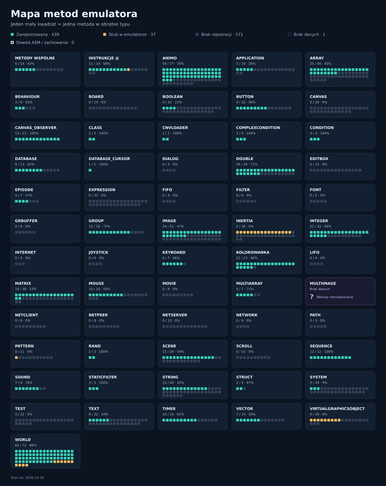

# Rex-EMoolator

**Polski** | [English](README.md)

[](https://github.com/patryk025/Rex-EMoolator/releases/latest)
[](https://patryk025.github.io/Rex-EMoolator/)
[](LICENSE)

Otwarto-źródłowy emulator odtwarzający zachowanie silnika Piklib/BlooMoo używanego w grach Aidem Media. Działa na Windowsie, Linuksie, macOS i Androidzie. Gier nie ma w zestawie: potrzebna jest własna kopia.

<table>
<tr>
<td width="33%"></td>
<td width="33%"></td>
<td width="33%"></td>
</tr>
</table>

Więcej w [galerii zrzutów ekranu](https://patryk025.github.io/Rex-EMoolator/emulator/screenshots/).

## Pierwsze kroki

1. Pobierz paczkę dla swojego systemu z [najnowszego wydania](https://github.com/patryk025/Rex-EMoolator/releases/latest).

   | System | Plik | Wymaga Javy |
   |---|---|---|
   | Windows | instalator `.exe` | nie |
   | macOS | obraz `.dmg` | nie |
   | Linux | pakiet `.deb` | nie |
   | Android 7.0+ | `.apk` | nie |
   | Dowolny | `.jar` lub `.zip` | Java 21+ |

2. Uruchom emulator i kliknij **Dodaj grę**.
3. Wskaż folder z grą, obraz płyty albo archiwum ZIP i zapisz.
4. Kliknij **Uruchom**.

[Przewodnik po emulatorze](https://patryk025.github.io/Rex-EMoolator/emulator/) opisuje ustawienia gier, skróty klawiszowe i miejsce przechowywania zapisów. Oficjalne i fanowskie poprawki można zainstalować z poziomu [menedżera łatek](https://patryk025.github.io/Rex-EMoolator/emulator/patches/).

## Stan gier

| Gra | Status | Tracking |
|---|---|---|
| Reksio i Skarb Piratów |  | [Projekt](https://github.com/users/patryk025/projects/3) |
| Reksio i UFO |  | [Projekt](https://github.com/users/patryk025/projects/4) |
| Reksio i Czarodzieje |  | [Projekt](https://github.com/users/patryk025/projects/6) |
| Reksio i Wehikuł Czasu |  | [Projekt](https://github.com/users/patryk025/projects/8) |
| Reksio i Kapitan Nemo |  | [Projekt](https://github.com/users/patryk025/projects/10) |
| Reksio i Kretes w Akcji! |  | [Projekt](https://github.com/users/patryk025/projects/11) |
| Poznaj Mity: Wyprawa po Złote Runo |  | [Projekt](https://github.com/users/patryk025/projects/12) |
| Poznaj Mity: Wojna Trojańska |  | [Projekt](https://github.com/users/patryk025/projects/13) |
| Poznaj Mity: Przygody Odyseusza |  | [Projekt](https://github.com/users/patryk025/projects/14) |
| Poznaj Mity: Herkules |  | [Projekt](https://github.com/users/patryk025/projects/15) |
| Tezeusz i Nić Ariadny |  | [Projekt](https://github.com/users/patryk025/projects/17) |

**Grywalne** oznacza, że grę da się ukończyć bez blokujących błędów. **W grze** oznacza, że działa, ale nie da się jej jeszcze ukończyć. [Strona stanu gier](https://patryk025.github.io/Rex-EMoolator/emulator/games/) zawiera uwagi do każdego tytułu, liczbę działających scen i pełną legendę, a bieżące testy scen prowadzone są w podlinkowanych projektach.

## Dokumentacja

[Dokumentacja](https://patryk025.github.io/Rex-EMoolator/) jest dostępna po polsku i angielsku:

- [Emulator](https://patryk025.github.io/Rex-EMoolator/emulator/): instalacja, ustawienia, łatki i budowanie ze źródeł.
- [Silnik](https://patryk025.github.io/Rex-EMoolator/engine/): język skryptowy, arytmetyka, zdarzenia i dziwactwa.
- [Wnętrze silnika](https://patryk025.github.io/Rex-EMoolator/internals/): architektura, pętla gry, renderowanie i animacje.
- [Formaty plików](https://patryk025.github.io/Rex-EMoolator/formats/): `ANN`, `IMG`, `FNT`, `ARR`, `SEK` i inne, bajt po bajcie.
- [Referencja typów](https://patryk025.github.io/Rex-EMoolator/reference/): każdy typ skryptowy z polami, metodami i sygnałami.

## Mapa metod

Jeden kwadrat to jedna metoda. Kolory opisują rejestracje i stuby w emulatorze,
nie zgodność zachowania z oryginałem. Fioletowe karty z „?” oznaczają brak danych
— szare kwadraty oznaczają rozpoznane metody bez dopasowanej rejestracji.

[](images/method-map.pl.svg)

[Interaktywna mapa w dokumentacji](https://patryk025.github.io/Rex-EMoolator/reference/method-map/) — wyszukiwanie metod, filtry statusów i sortowanie.

## Budowanie ze źródeł

Wystarczy JDK 21 lub nowszy, a wrapper Gradle'a jest w repozytorium. Do budowania na Androida potrzebny jest też Android SDK wskazany przez `local.properties` (`sdk.dir=...`) albo `ANDROID_HOME`.

```bash
./gradlew desktop:run            # uruchomienie emulatora
./gradlew desktop:build          # JAR i ZIP dystrybucyjny
./gradlew android:assembleDebug  # APK na Androida
./gradlew :core:test             # testy
```

Na Windowsie użyj `gradlew.bat`. [Przewodnik po budowaniu](https://patryk025.github.io/Rex-EMoolator/emulator/development/) opisuje ścieżki wynikowe, instalatory i pozostałe zadania.

## Licencja

Sam Rex-EMoolator jest projektem otwarto-źródłowym udostępnianym na
**licencji MIT**. Pełną treść licencji znajdziesz w pliku [`LICENSE`](LICENSE).

Projekt korzysta z różnych bibliotek (m.in. libGDX, LWJGL czy ODE4J), z których każda
posiada własną licencję. Pełną listę tych bibliotek wraz z ich licencjami
znajdziesz w pliku [`THIRD-PARTY-NOTICES.md`](THIRD-PARTY-NOTICES.md).

Jeśli interesuje Cię, jak dbamy o zgodność z licencjami LGPL (np. w przypadku
bibliotek JLayer czy JOrbis), wszystkie szczegóły techniczne również opisaliśmy
w tym pliku.

Licencja MIT dotyczy kodu źródłowego emulatora znajdującego się w tym
repozytorium. Dane gier, mody, fanowskie tłumaczenia, patche i inne treści
ładowane przez emulator są odrębnymi utworami i podlegają własnym licencjom,
zgodom oraz ograniczeniom prawnoautorskim.

### Kilka słów o materiałach z gier

Ten emulator powstał w celach edukacyjnych, archiwizacyjnych i związanych z
interoperacyjnością. Możesz używać go z oryginalnymi plikami gier, własnymi
kopiami, fanowskimi modami, tłumaczeniami, patchami i innymi kompatybilnymi
zasobami, o ile masz prawo legalnie z nich korzystać.

Nie rozpowszechniamy grafik, muzyki ani innych danych chronionych prawem
autorskim z oryginalnych gier. Katalog `assets/` zawiera jedynie minimalne,
techniczne fragmenty używane do testów automatycznych, by mieć pewność, że
silnik działa poprawnie.

Rex-EMoolator jest niezależnym projektem i nie jest w żaden sposób powiązany z oryginalnymi twórcami czy właścicielami praw do
gier. Emulator jest udostępniany w dobrej wierze, „tak jak jest”, bez jakichkolwiek gwarancji, jako narzędzie badawcze i dokumentacyjne.
