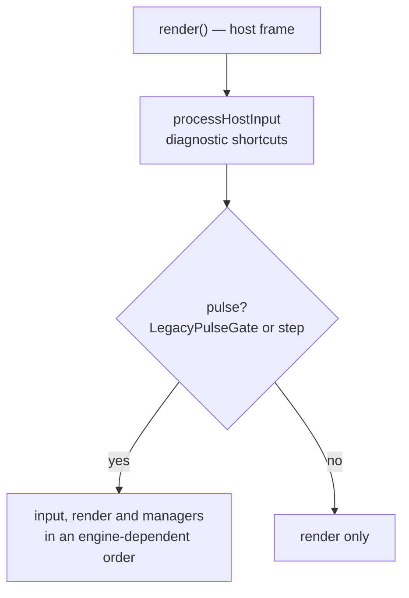

# Game loop and engine clock

The whole game is driven by one loop: LibGDX calls `render()` once per host frame. Game state, however, is not computed "every frame". The emulator recreates the original's rhythm: it runs engine **pulses** and reads time from a **coarse-resolution clock**, like `GetTickCount` on old systems. This chapter describes both mechanisms and the pause and stepping modes.

## Host frame and engine pulse

Two independent rhythms run in the loop:

| | Host frame | Engine pulse |
|---|---|---|
| Rate | set by the backend (`vsync`, `targetFPS = 60`) | at most `legacyPulseHz = 60` times per second and at most once per frame |
| Work | diagnostic shortcuts, drawing, debug overlay | script-visible input, timers, animations, audio, collisions |
| After a stall | nothing to catch up on | missed pulses are lost |

The split protects scripts from high refresh rates. If input and managers ran every frame, a 144 Hz monitor would speed up key repeat, mouse-move handlers, and button state machines.



`LegacyPulseGate` decides on the pulse. It admits the first poll immediately and later ones at most once every `1/60 s`. A late poll moves the deadline past the current time, which **discards** the missed pulses instead of catching up. The gate is authoritative because not every backend honours `setForegroundFPS` (`AndroidGraphics` does not).

### Phase order

The order of input, drawing, and managers is visible to scripts and differs between engines, so it is held by `LegacyFrameOrder`, assigned in the [compatibility profile](architecture.md#compatibility-profile):

| Engine | Frame with a pulse |
|---|---|
| Piklib 6.1, 7.1, 7.2 | input → managers → render |
| Piklib 8 | input → render → managers |
| BlooMoo, including "Reksio i Wehikuł Czasu" | render → input → managers |

A frame without a pulse runs only the render. The [debug overlay](../emulator/index.md#keyboard-shortcuts) is always drawn along with it.

## Work done in a pulse

```java
public void pulse() {
    updateTimers();      // (1)
    updateAnimations();
    updateAudio();
    updateCollisions();  // (2)
}
```

1. [Timers](timers.md) and [animations](animation.md) read time from the [engine clock](#engine-clock), not from a pulse counter.
2. Collisions are computed only for objects marked as changed since the last check.

The order is fixed: **timers → animations → audio → collisions**.

## Engine clock

`Game.getEngineTimeMs()` returns the time from `LegacyClock`: a monotonic clock in whole milliseconds, counted from the start of the game. The `QuantizedLegacyClock` implementation reads `System.nanoTime()` and rounds the result down to a quantum, so the value jumps in steps, just like `GetTickCount`. The clock follows real time and depends neither on the frame rate nor on the number of pulses.

The quantum is chosen per game (`LegacyClockProfile`):

| Profile | Quantum |
|---|---:|
| Windows 11 / 64 Hz (default) | 15.625 ms |
| Windows XP / 100 Hz | 10 ms |
| QEMU / 86Box measured in Windows 98 | 5 ms |
| Windows 9x, nominal value | 54.9254 ms |
| 1 ms | 1 ms |

A profile describes a compatibility target, not the system the emulator runs on.

!!! tip "Consequence for scripts"
    A [timer](../reference/TIMER.md) set to `1000 ms` fires after one second of real time, accurate to the clock quantum and the nearest pulse, whether the game runs at 30 or 240 FPS. Two runs can still differ by a few milliseconds, just like in the original.

!!! quote "How the original did it"
    The original's schedulers compare time from `GetTickCount`: `CAnimationManager::domodal` selects the animations whose frame time has elapsed with a single reading, and `CXTimer` reads the clock again after calling the timer handler. The resolution of that clock depends on the system, hence the profiles above. The engine libraries also import `QueryPerformanceCounter` (class `CHiResTimer` — globals `appTime`, `frameTime`, `fps`) and the multimedia `timeSetEvent`. The rate of 60 pulses per second is an emulator setting.

## Pause and stepping

The loop supports two diagnostic modes controlled by `EngineConfig`:

| Mode | Key | Behaviour |
|---|---|---|
| **Pause** (`paused`) | `F11` | No pulses run, so game state stands still. Frames keep rendering and diagnostic shortcuts keep working. |
| **Step** (`stepFrame`) | `F12` | Forces exactly **one** pulse, bypassing the gate. While paused, it lets you scrub the game pulse by pulse. |

!!! warning "The diagnostic pause does not stop the clock"
    `LegacyClock` keeps running, and the pause only holds back pulses. When it is lifted, timers and animations that are due run once, without catching up. Scene pauses (`SCENE^PAUSE`) follow separate rules, described in [the architecture chapter](architecture.md#lexical-scope-vs-playback-scope).

## Related topics

- [Rendering](rendering.md) — what happens in the "render" step.
- [Animation system](animation.md) — how animations use the engine clock.
- [Time and timers](timers.md) — `TIMER` and the `ONTICK` signal.
