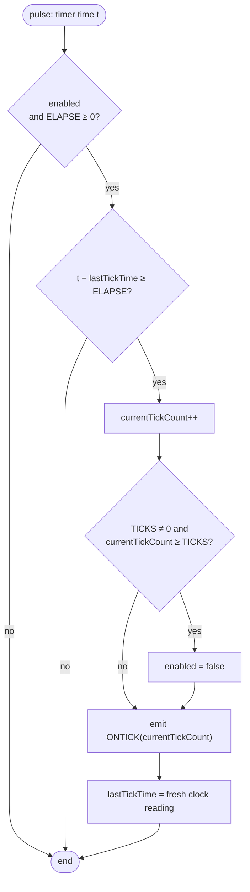

# Time and timers

A [`TIMER`](../reference/TIMER.md#timer) object is a cyclic time counter: every set interval it emits an `ONTICK` signal, to which a script attaches a handler. Timers are the basic tool for delays, script-driven animated transitions, and repeated actions. This chapter describes how timers count time and how their methods behave.

## Time measured by the engine clock

Timers are checked on every [engine pulse](loop.md#host-frame-and-engine-pulse), and they read time from the coarse-resolution [engine clock](loop.md#engine-clock), which follows real time. More precisely, they use `Game.getTimerTimeMs()`: the same clock minus the time a scene kept timers paused.

!!! tip "Accuracy and pausing"
    A timer set to `1000 ms` ticks after one second of real time, accurate to the clock quantum (15.625 ms by default) and the nearest pulse, regardless of the frame rate. [`SCENE^PAUSE`](../reference/SCENE.md#pause) freezes timer time, unless it was called as `PAUSE(TRUE)`. The [diagnostic pause](loop.md#pause-and-stepping) only holds back pulses, and the clock keeps running.

## Timer fields

| Field | Meaning |
|---|---|
| `ELAPSE` | the interval between ticks, in milliseconds |
| `TICKS` | the maximum number of ticks; `0` means **no limit** |
| `enabled` | whether the timer is currently ticking |
| `currentTickCount` | how many ticks have already occurred (the value carried by `ONTICK`) |
| `lastTickTime` | the time of the last tick (the interval accumulator) |

## Tick logic

On every pulse the engine calls `update()` on the timer:

Key details:

- at most one tick happens per pulse, so late ticks are not caught up,
- `lastTickTime` is set only **after** the `ONTICK` handler, from a fresh clock reading, so the handler's execution time does not count towards the next interval,
- when the counter reaches a positive `TICKS`, the timer disables itself **before** the last handler, which lets the handler re-enable it with `ENABLE`,
- with `TICKS = 0` the timer ticks forever, until `DISABLE`,
- with `ELAPSE = 0` the timer ticks on every pulse.

!!! note "Granularity"
    The check happens once per pulse (usually every ~16.67 ms), and the clock jumps by the profile's quantum. In practice the interval is rounded up to the first pulse at which the clock shows the threshold has been crossed.

## Methods and their pitfalls

Some methods have behaviour that's easy to overlook — it was mirrored directly from the original BlooMooDLL:

| Method | Action | Note |
|---|---|---|
| [`ENABLE`](../reference/TIMER.md#enable) | enables the timer, zeroes the counter, restarts the interval window | **a no-op if the timer is already enabled** — it does not zero the counter then |
| [`DISABLE`](../reference/TIMER.md#disable) | stops ticking | keeps `currentTickCount` |
| [`RESET`](../reference/TIMER.md#reset) | zeroes `currentTickCount` and restarts the interval window | does not change `enabled` |
| [`SET`](../reference/TIMER.md#set) | sets `TICKS` **and** zeroes the slot (counter + window) | not just the limit |
| [`SETELAPSE`](../reference/TIMER.md#setelapse) | changes `ELAPSE` | **keeps the accumulator** (`lastTickTime`) — retuning the interval on the fly no longer loses the time already counted |
| [`GETTICKS`](../reference/TIMER.md#getticks) | returns `currentTickCount` | |

!!! warning "`ENABLE` on an enabled timer does nothing"
    To restart an already-ticking timer (zero the counter and the countdown), use [`RESET`](../reference/TIMER.md#reset) or `DISABLE` + `ENABLE`. `ENABLE` alone will be ignored.

## How it differs from the original

In `bloomoodll.dll`, timers are handled by the `CXTimer`/`CTimerNotificator` classes, not by the render loop. Rex-EMoolator instead checks them on the [engine pulse](loop.md#host-frame-and-engine-pulse). The tick logic itself is the same, though: like `CXTimer`, the emulator reads the clock again after calling the handler.

!!! quote "Confirmed by decompilation"
    The `CMC_Timer::onTimer` method in the original library does exactly what's described above: it checks the "enabled" flag, increments the tick counter, disables the timer once the `TICKS` limit is reached, and then emits the parameterised `ONTICK^<count>` signal followed by `ONTICK`.

## Related topics

- [`TIMER`](../reference/TIMER.md#timer) — reference of methods and signals.
- [Game loop and engine clock](loop.md) — the time source for timers.
- [Events and signals](../engine/events.md) — how `ONTICK` propagates through the call tree.
