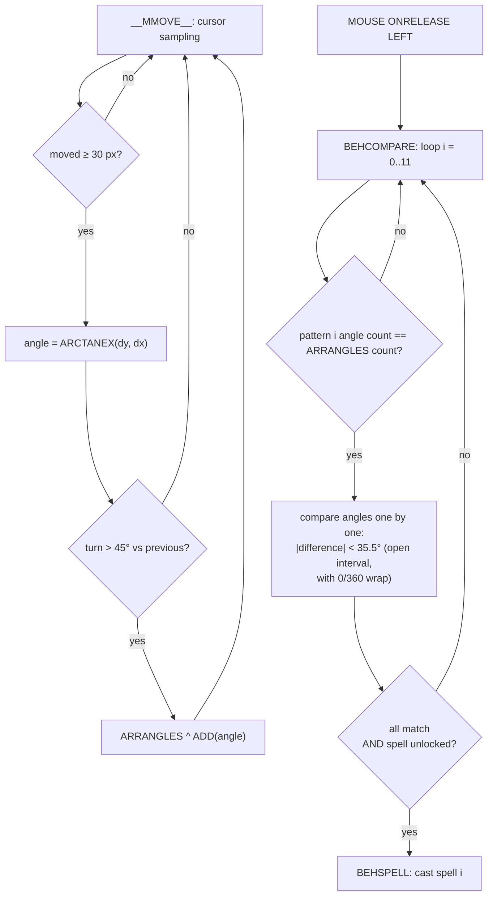
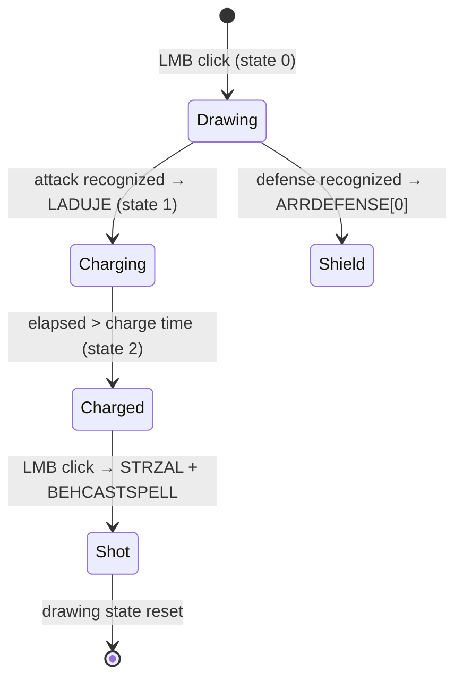

# Spell duel

The spell-duel minigame (the `Magic.cnv` scene in `Dane/Game/Przygoda/Magic`) lets you "draw" spells in the air with the cursor. The player traces a gesture with the left mouse button held down; on release the engine tries to **match the shape against one of the known patterns** and — if it succeeds and the spell is unlocked — casts it.

All the logic lives in the script: one sprawling dispatcher with duplicated procedures and fragments of dead code (see [Bugs and relics](#bugs-and-relics-of-the-original)). Below it is taken apart piece by piece; the semantics of the engine methods the script relies on were verified by decompiling `Piklib8.dll` — see [Engine contracts](#engine-contracts).

## Overview

The duel is entered from the adventure: the global variable `S_IMAGICFIGHTER` selects a record from the `$COMMON\FIGHTERS.DTA` database (opponent, place, spell repertoire, wand-charge time). ID ranges trigger different variants of the scene:

| `S_IMAGICFIGHTER` | Variant |
|---|---|
| `0–12` and `30` | regular duel (for `<13` or `=30` the opponent attacks on its own) |
| `13–24` | tutorial lessons (learning specific attacks and defenses) |
| `25–29`, `31–39` | filler records (`NULL`) |
| `> 39` | practice mode: the practiced spell has code `S_IMAGICFIGHTER − 40` |

Scene exits: victory and a completed practice return to the `ARCADE` scene (the place is saved via `S_SMAGICPLACE`); defeat and fleeing a regular fight lead to `LIMBO`.

## Duel model

The game defines **12 spell codes**: attacks `0–5` and their matching defenses `6–11` (defense `k+6` neutralizes attack `k`).

| Attack code | Spell | Defense code |
|---:|---|---:|
| 0 | Sleep | 6 |
| 1 | Frog transformation | 7 |
| 2 | Plague of flies | 8 |
| 3 | Pudding ball | 9 |
| 4 | Circles and whirls | 10 |
| 5 | Darkness | 11 |

Key rules:

- **There are no hit points.** Each side has six independent effect-level counters (`ARREFFECTLEVEL0` for Rex, `ARREFFECTLEVEL1` for the opponent). A landed attack raises the matching counter by 1.
- **The duel ends at the third level of the *same* effect** — three hits with different spells decide nothing. `VARIWINNER` stores the index of the *defeated* side (`1` = opponent lost, i.e. Rex won).
- The player can only cast **unlocked** spells: the `ARRACTIVESPELLS[0..11]` flags are copied at startup from the global `G_ARRREXSPELLS[0..11]` array (persistent progress — see [Tutorial](#tutorial-practice-and-progress-saving)).
- The opponent does not "really" draw — it replays pre-recorded choreography and never goes through shape recognition (see [Opponents and AI](#opponents-and-ai)).

## Controls: the virtual cursor

The scene does not use the system mouse position directly. `MOUSE:ONMOVE` implements **relative** control:

1. Computes the delta from the anchor point: `dx = mouseX − 400`, `dy = mouseY − 300`.
2. Divides it by `ARRSPEEDFACTOR[0]` (grows under the pudding effect — the cursor slows down).
3. Adds the result to the virtual cursor position `VARICURSORX/Y`; the Y component additionally receives a one-shot `ARRJUMP[0]` hop (frog effect).
4. Clamps the position to `[0,800] × [0,600]` (`CLAMP`).
5. Moves the graphical `G_CURSOR` without firing its callbacks and **re-centers the system mouse back to `(400,300)`**.

This lets the player "push" the cursor indefinitely without ever hitting the physical screen edge. The script also contains virtual-cursor disturbances for active effects (some are blocked by release-scene bugs described below):

- **whirls** — the `STL8` clock adds a sinusoidal drift with amplitude `ARRSLIDE[0]`;
- **flies** — if a fly animation is found under the cursor (priority range `40..40`), the cursor is dragged along with it for a few frames;
- **sleep** — drawing is interrupted and the wand droops (`ZWISA`) for as long as the head plays the `SPI` event.

While drawing, every move event additionally advances the wand animation frame by `0.1` (`BFITMP46` — the wand smoothly "traces"), and then explicitly calls `__MMOVE__^RUN()`. `__MMOVE__` is **not** an automatic engine callback — the DLL only emits `ONMOVE`, once per delivered mouse-move event.

## Gesture recognition

### Two representations of a spell (the trap)

The key observation: a spell exists in the scripts in **two independent forms** that are easy to confuse.

=== "Angle sequence — for recognition"

    Arrays `ARRPATTERN0..11` are hardcoded **sequences of direction angles** (mostly on a 45° grid), added in `__INIT__`. The player's gesture is matched against **these**. Player input is **not** compared against the point clouds.

=== "Point cloud — for playback only"

    Files `spellN_0.arr` / `spellN_1.arr` (and `tut_*`, `spell_pent/n/nb/box`) are parallel lists of **X** and **Y** coordinates of a polyline — see the [ARR format](../formats/ARR.md). They are used **for playback only**: they render the gesture as a trail of clones when the enemy casts a spell or the tutorial demonstrates one. Loaded by `BEHLOADSPELL` (`$1+"0.ARR"` → `ARRENEMYROUTEX`, `$1+"1.ARR"` → `ARRENEMYROUTEY`).

!!! warning "We do not recognize by the point cloud"
    The most common mistake when reading these scripts: it looks like the player's gesture is compared against the stored `.arr` routes. It is not. The `.arr` routes are graphics (the spell trail); recognition operates on the **angle sequence** in `ARRPATTERN`.

### From gesture to angle sequence (`ARRANGLES`)

Drawing starts with a left click (while no spell is charged): the script clears `ARRROUTEX/Y` and `ARRANGLES`, sets `VARDLASTTAN = −1` and enables drawing mode (`VARIDOMAGIC = 1`). While drawing, the `__MMOVE__` behaviour reduces the cursor trail to a sequence of "corner" headings in the `ARRANGLES` array:

1. A segment is **ignored** until the cursor has moved at least **30 px** from the last *accepted* sample (`LENGTH < 30 → @BREAK`). This filters out a shaky hand; the distance accumulates from the last accepted point, not from the previous mouse event.
2. The segment heading is `ARCTANEX(dy, dx)` — `atan2` returning **degrees 0–360**. The canvas Y axis points **down** (see [Coordinates & anchors](../internals/coordinates.md)), so the direction encoding is:

<svg viewBox="0 0 300 210" role="img" aria-label="Direction encoding: 0°=right, 90°=down, 180°=left, 270°=up, with the Y axis pointing down" xmlns="http://www.w3.org/2000/svg" style="max-width:320px;width:100%;height:auto">
  <defs>
    <marker id="ah-dir-en" markerWidth="9" markerHeight="9" refX="6" refY="3" orient="auto">
      <path d="M0,0 L6,3 L0,6 Z" fill="currentColor"/>
    </marker>
  </defs>
  <!-- 8 spokes from center (150,105), r=60 -->
  <line x1="150" y1="105" x2="210" y2="105" stroke="currentColor" stroke-width="1.5" marker-end="url(#ah-dir-en)"/>
  <line x1="150" y1="105" x2="192" y2="147" stroke="currentColor" stroke-width="1.5" marker-end="url(#ah-dir-en)"/>
  <line x1="150" y1="105" x2="150" y2="165" stroke="currentColor" stroke-width="1.5" marker-end="url(#ah-dir-en)"/>
  <line x1="150" y1="105" x2="108" y2="147" stroke="currentColor" stroke-width="1.5" marker-end="url(#ah-dir-en)"/>
  <line x1="150" y1="105" x2="90"  y2="105" stroke="currentColor" stroke-width="1.5" marker-end="url(#ah-dir-en)"/>
  <line x1="150" y1="105" x2="108" y2="63"  stroke="currentColor" stroke-width="1.5" marker-end="url(#ah-dir-en)"/>
  <line x1="150" y1="105" x2="150" y2="45"  stroke="currentColor" stroke-width="1.5" marker-end="url(#ah-dir-en)"/>
  <line x1="150" y1="105" x2="192" y2="63"  stroke="currentColor" stroke-width="1.5" marker-end="url(#ah-dir-en)"/>
  <text x="216" y="108" font-size="11" fill="currentColor" text-anchor="start">0° →</text>
  <text x="196" y="162" font-size="11" fill="currentColor" text-anchor="start">45° ↘</text>
  <text x="150" y="180" font-size="11" fill="currentColor" text-anchor="middle">90° ↓</text>
  <text x="104" y="162" font-size="11" fill="currentColor" text-anchor="end">135° ↙</text>
  <text x="84"  y="108" font-size="11" fill="currentColor" text-anchor="end">180° ←</text>
  <text x="104" y="58"  font-size="11" fill="currentColor" text-anchor="end">225° ↖</text>
  <text x="150" y="38"  font-size="11" fill="currentColor" text-anchor="middle">270° ↑</text>
  <text x="196" y="58"  font-size="11" fill="currentColor" text-anchor="start">315° ↗</text>
</svg>

3. A new heading is appended to `ARRANGLES` **only when the turn relative to the previous one exceeds 45°** circularly (the condition is `45 < |Δ| < 315`; differences in `[315°, 360°)` are small turns crossing 0°). The first segment is forced (the difference is set to 46°). A straight run therefore yields **one** angle, and each sharp corner adds another.
4. Regardless of whether an angle was added, the point goes into `ARRROUTEX/Y` (the visual trail for later replay), and one of the 10 cycling wand particles (`ANNMAGIC` clones) follows the cursor.

The result: the gesture is reduced to a short list of directions, e.g. "up, down-right, up, down-left, right". `ARRROUTEX/Y` usually holds more points than `ARRANGLES` — the former is graphics, the latter is the reduced corner description.

### Matching against a pattern

Releasing the button runs the comparator:

1. Trigger: `MOUSE:ONRELEASE^LEFT → BFITMP61 → BEHCOMPARE^RUN()`.
2. `BEHCOMPARE` iterates `i = 0..11` **in that order** — the first matching pattern wins. The angle-by-angle comparison fires **only when `GETSIZE(ARRPATTERNi) == GETSIZE(ARRANGLES)`** — i.e. when the corner count matches exactly.
3. `BEHCOMPPATTERN` + `BFITMP114`: every drawn angle must fall within the **open interval `pattern ± 35.5°`** (strict `>` and `<` — a value exactly on the boundary fails), with full 0/360 wrap handling (the whole `BFITMP104..113` ladder is just the "lower bound < 0" / "upper ≥ 360" / "middle" cases). The first mismatch sets a flag and aborts.
4. `BFITMP119`: a full hit requires `matched_count == pattern_length` **and** `ARRACTIVESPELLS[i] == 1` (spell unlocked) → `BEHSPELL^RUN()` casts. Indexes 0–5 are attacks, 6–11 defenses (`BEHSPELL` branches on `> 5`).

Recognition ignores: the starting position, the drawing's scale, segment lengths and proportions — only the **sequence of directions** matters, as long as every needed segment reaches 30 px.

!!! tip "The tolerance is generous"
    A ±35.5° tolerance on a 45° grid means adjacent directions overlap almost edge-to-edge — the gesture does not have to be precise as long as the **sequence** of corners is right. Whether it was deliberately tuned "for younger players" is a hypothesis — the script doesn't say.

!!! example "Recognition simulator"
    You can try the algorithm in the [interactive simulator](duel-shape-recognize.html){target=_blank} — drawing a gesture shows live 30 px sampling, detected corners and the comparison run against each of the 12 patterns.

## Spell catalog

The order in `ARRCOMPSPELLS` corresponds to the `ARRPATTERN` index. Directions were decoded using the encoding above. The `SPELL0_`–`SPELL5_` attack files store choreography for the **opponent facing Rex**, so their raw routes are horizontal mirror images of the player's patterns; thumbnails 0–5 are flipped back. Defense routes 6–11 are already stored from the player's perspective and remain unflipped. All thumbnails show playback choreography, not data consumed directly by the recognizer. **The arrowhead marks the end of the route and indicates the drawing direction.**

<svg xmlns="http://www.w3.org/2000/svg">
  <defs>
    <marker id="spell-trace-arrow" markerWidth="14" markerHeight="14" refX="13" refY="7" orient="auto" markerUnits="userSpaceOnUse">
      <path d="M0,0 L14,7 L0,14 Z" fill="currentColor"/>
    </marker>
    <g id="spell-trace-0"><polyline points="103.75,74 103.75,57 103.75,42 103.25,27 102.25,12 85.75,24 71.25,37.5 61.25,49 45.25,48 34.25,34 26.25,20.5 20.75,6 16.25,22 16.25,39.5 16.25,54.5 16.25,71"/></g>
    <g id="spell-trace-1"><polyline points="92.65,17.59 93.42,29.18 93.81,42.32 93.81,54.3 94.19,66.27 84.15,72.45 69.85,72.84 57.1,72.84 44.74,74 33.15,74 30.44,60.48 30.06,46.95 30.06,33.82 28.51,21.84 25.81,8.32 38.56,6 53.63,6.77 65.6,6.77 77.97,6.77 72.94,18.75 64.06,26.86 52.47,34.2 61.35,44.64 71.4,50.82 81.44,57.39"/></g>
    <g id="spell-trace-2"><polyline points="58.32,6 58.65,17.78 58.99,30.24 58.99,41.01 58.99,51.78 58.65,63.9 58.65,74 66.06,66.26 73.13,58.51 79.19,50.44 86.26,42.02 76.5,35.29 65.39,34.95 53.94,34.61 43.84,32.93 33.74,33.6 36.77,23.84 44.18,15.43 54.28,7.35"/></g>
    <g id="spell-trace-3"><polyline points="27.8,7.55 43.77,7.55 61.29,6 76.74,6.52 92.2,7.03 99.41,23 89.62,36.39 74.17,36.91 57.17,35.88 41.71,35.88 25.74,35.36 20.59,52.88 21.11,68.33 36.56,74 54.59,74 72.62,74 89.62,73.48"/></g>
    <g id="spell-trace-4"><polyline points="93.07,65.15 92.14,50.71 92.6,36.27 92.14,19.97 89.81,6 79.1,17.18 70.71,29.29 61.4,40.47 51.62,51.64 40.9,62.82 30.66,74 27.86,56.3 27.86,40.93 27.4,26.03 26.93,12.05 38.11,22.3 49.29,33.95 60.47,45.59 72.11,54.9 82.36,65.62 68.38,72.14 53.48,71.21 39.51,70.27"/></g>
    <g id="spell-trace-5"><polyline points="90.91,73.59 78.55,74 64.95,73.59 50.93,74 37.75,73.18 45.99,63.7 55.47,53.81 64.95,45.15 62.47,32.38 51.35,24.96 39.39,18.36 29.09,11.36 41.45,6 56.29,6 69.48,6 83.08,6.41"/></g>
    <g id="spell-trace-6"><polyline points="40.88,7.18 48.9,6.94 56.69,6.71 65.67,6.71 72.75,6.47 80.31,6 85.97,10.72 85.97,18.99 85.97,27.25 85.97,35.04 86.68,43.31 86.68,51.81 86.68,59.83 85.74,66.92 85.74,74 78.42,73.53 70.86,73.29 62.13,73.29 55.04,73.29 46.54,73.53 38.28,73.29 33.32,67.86 33.56,60.54 34.03,52.99 34.03,45.43 34.5,38.11 44.18,35.04 52.21,36.22 59.29,36.22 68.74,36.22 75.82,35.99"/></g>
    <g id="spell-trace-7"><polyline points="13.96,46.02 12.66,36.26 11.68,23.24 11.03,12.51 21.12,6 30.88,6 41.62,6 51.38,6 53.66,16.41 54.31,27.8 54.31,38.54 54.31,50.25 54.31,61.31 54.31,71.07 66.34,74 79.36,73.35 90.1,72.37 100.83,72.7 107.67,64.89 107.99,55.13 107.99,43.74 108.97,31.7 108.64,19.34 107.99,9.58 97.9,9.25 88.14,17.06 74.48,25.2 60.16,40.16 48.45,48.95 39.34,58.38 30.23,66.52 21.44,72.7"/></g>
    <g id="spell-trace-8"><polyline points="94.94,30.2 89.1,26.44 83.67,23.1 77,18.52 71.79,14.55 66.36,10.38 59.9,6 53.85,8.92 49.47,13.93 43.42,20.39 38.41,24.56 33.4,29.36 29.65,34.99 25.06,39.37 30.9,45.21 38.2,50.22 43.83,55.23 49.05,58.98 54.68,64.61 59.69,69.2 63.86,74 68.45,68.99 71.37,63.36 76.17,59.19 81.17,54.81 86.18,49.39 90.77,43.75"/></g>
    <g id="spell-trace-9"><polyline points="113.67,67.67 113.33,56 113.33,44.33 114,34 114,23 102.67,19.33 86.67,19.67 76.67,19.67 70.33,31 69.67,45.67 69.33,61.33 69.67,72 59.67,71 48.67,69 35,67 21,65.33 9,65.33 6,55.33 7,39.33 7.67,28.67 7.67,18 7.67,8"/></g>
    <g id="spell-trace-10"><polyline points="61.47,30.9 66.83,37.06 71.91,44.55 79.14,54.99 88.78,66.77 92.8,73.73 81.55,74 73.52,73.46 63.35,73.2 53.98,72.39 45.94,72.66 36.57,72.66 27.2,72.66 35.5,57.94 46.48,45.89 51.83,39.73 60.94,32.77 68.97,25.01 76.2,18.31 84.76,12.16 91.19,7.07 80.48,6 70.84,6 58.26,6 48.62,6 38.18,6"/></g>
    <g id="spell-trace-11"><polyline points="86.12,6 78.48,6 70.59,6 61.23,6 53.35,6.25 44.72,6.49 36.35,6 28.96,6.25 35.36,15.86 40.29,22.26 45.96,29.41 50.88,35.57 58.28,41.48 53.84,50.35 47.19,56.26 39.8,61.43 30.19,70.3 38.07,74 46.45,73.75 54.09,73.01 62.22,73.01 70.84,73.01 80.7,73.01 91.04,73.26"/></g>
  </defs>
</svg>

| # | Spell | Pattern (angles) | Directions | `.arr` route | `.arr` ID (playback) | Type |
|---:|---|---|---|---|---|---|
| 0 | Sleep | 270, 45, 315, 90 | ↑ ↘ ↗ ↓ | <svg viewBox="0 0 120 80" role="img" aria-label="Sleep spell route" style="width:120px;height:80px"><use href="#spell-trace-0" fill="none" stroke="currentColor" stroke-width="3.5" stroke-linecap="round" stroke-linejoin="round"></use></svg> | `SPELL0_` | attack |
| 1 | Frog transformation | 90, 0, 270, 180, 45, 135 | ↓ → ↑ ← ↘ ↙ | <svg viewBox="0 0 120 80" role="img" aria-label="Frog transformation spell route" style="width:120px;height:80px"><use href="#spell-trace-1" fill="none" stroke="currentColor" stroke-width="3.5" stroke-linecap="round" stroke-linejoin="round"></use></svg> | `SPELL1_` | attack |
| 2 | Plague of flies | 90, 225, 0, 225 | ↓ ↖ → ↖ | <svg viewBox="0 0 120 80" role="img" aria-label="Plague of flies spell route" style="width:120px;height:80px"><use href="#spell-trace-2" fill="none" stroke="currentColor" stroke-width="3.5" stroke-linecap="round" stroke-linejoin="round"></use></svg> | `SPELL2_` | attack |
| 3 | Pudding ball | 180, 90, 0, 90, 180 | ← ↓ → ↓ ← | <svg viewBox="0 0 120 80" role="img" aria-label="Pudding ball spell route" style="width:120px;height:80px"><use href="#spell-trace-3" fill="none" stroke="currentColor" stroke-width="3.5" stroke-linecap="round" stroke-linejoin="round"></use></svg> | `SPELL3_` | attack |
| 4 | Circles and whirls | 270, 45, 270, 135, 0 | ↑ ↘ ↑ ↙ → | <svg viewBox="0 0 120 80" role="img" aria-label="Circles and whirls spell route" style="width:120px;height:80px"><use href="#spell-trace-4" fill="none" stroke="currentColor" stroke-width="3.5" stroke-linecap="round" stroke-linejoin="round"></use></svg> | `SPELL4_` | attack |
| 5 | Darkness | 0, 225, 315, 180 | → ↖ ↗ ← | <svg viewBox="0 0 120 80" role="img" aria-label="Darkness spell route" style="width:120px;height:80px"><use href="#spell-trace-5" fill="none" stroke="currentColor" stroke-width="3.5" stroke-linecap="round" stroke-linejoin="round"></use></svg> | `SPELL5_` | attack |
| 6 | Sleep defense | 0, 90, 180, 270, 0 | → ↓ ← ↑ → | <svg viewBox="0 0 120 80" role="img" aria-label="Sleep defense route" style="width:120px;height:80px"><use href="#spell-trace-6" fill="none" stroke="currentColor" stroke-width="3.5" stroke-linecap="round" stroke-linejoin="round"></use></svg> | `TUT_SLEEPDEF_` | defense |
| 7 | Frog defense | 280, 0, 90, 0, 270, 135 | ↑ → ↓ → ↑ ↙ | <svg viewBox="0 0 120 80" role="img" aria-label="Frog defense route" style="width:120px;height:80px"><use href="#spell-trace-7" fill="none" stroke="currentColor" stroke-width="3.5" stroke-linecap="round" stroke-linejoin="round"></use></svg> | `TUT_FROGDEF_` | defense |
| 8 | Flies defense | 225, 135, 45, 315, 180 | ↖ ↙ ↘ ↗ ← | <svg viewBox="0 0 120 80" role="img" aria-label="Flies defense route" style="width:120px;height:80px"><use href="#spell-trace-8" fill="none" stroke="currentColor" stroke-width="3.5" stroke-linecap="round" stroke-linejoin="round"></use></svg> | `TUT_FLIESDEF_`[^typo] | defense |
| 9 | Pudding defense | 270, 180, 90, 180, 270 | ↑ ← ↓ ← ↑ | <svg viewBox="0 0 120 80" role="img" aria-label="Pudding defense route" style="width:120px;height:80px"><use href="#spell-trace-9" fill="none" stroke="currentColor" stroke-width="3.5" stroke-linecap="round" stroke-linejoin="round"></use></svg> | `TUT_PUDDINGDEF_` | defense |
| 10 | Whirls defense | 45, 180, 315, 180 | ↘ ← ↗ ← | <svg viewBox="0 0 120 80" role="img" aria-label="Whirls defense route" style="width:120px;height:80px"><use href="#spell-trace-10" fill="none" stroke="currentColor" stroke-width="3.5" stroke-linecap="round" stroke-linejoin="round"></use></svg> | `TUT_WHIRLSDEF_` | defense |
| 11 | Darkness defense | 180, 45, 135, 0 | ← ↘ ↙ → | <svg viewBox="0 0 120 80" role="img" aria-label="Darkness defense route" style="width:120px;height:80px"><use href="#spell-trace-11" fill="none" stroke="currentColor" stroke-width="3.5" stroke-linecap="round" stroke-linejoin="round"></use></svg> | `TUT_DARKDEF_` | defense |

[^typo]: The script actually stores `TUT_FIESDEF_` — a typo missing the `L`; see [Bugs and relics](#bugs-and-relics-of-the-original).

Pattern 6 (→ ↓ ← ↑ →) is a closed square. Pattern 7 really does start with `280` — that is not a transcription error.

Besides the above, the disk holds **playback-only** trails with no recognition pattern of their own: `tut_sleep_`..`tut_dark_` (the opponent's demonstration casts in the tutorial) and `spell_pent`, `spell_n`, `spell_nb`, `spell_box` (prototype shapes — pentagram, zigzag, double wave, frame respectively; `spell_nb` and `spell_box` are unused by either scene).

## Casting and the player's defense

A recognized **attack** (code 0–5) does not act immediately — it goes through the `VARISPELLREADY` state machine:

1. `BEHSPELL` replays the whole recorded trail (`ARRROUTEX/Y`) with `ANNSPELL_n` clones and starts the charging animation `ANNWAND0:LADUJE`.
2. Every `LADUJE` frame change increments `ARRTIMEELAPSED[0]`. The readiness check is **strict** (`elapsed > time`), so it takes `time + 1` callbacks; the player's charge time is `G_ARRREXSPELLS[12]`.
3. In the "charged" state, the next click fires `STRZAL` and `BEHCASTSPELL`: a **pixel-accurate hit test** runs under the cursor — `GETGRAPHICSAT(x, y, TRUE, 10, 20, FALSE)`, where `10, 20` is the **priority** range covering the opponent's parts (body 10, head 15, boss robes 17, wand 20), and `FALSE` forces a real opaque-pixel test. Hitting anything outside `ARRENEMYPARTS` **wastes the shot with no effect**.
4. A hit: the `ANNCLOUD` puff on the opponent and `BEHAPPLYSPELL(1, code)` — raising the effect level (see below).

A recognized **defense** (code 6–11) has no charging phase: the script stores `ARRDEFENSE[0] = code − 6` and shows the `ANNSHIELD` shield. The defense is:

- **typed** — it neutralizes only the attack with the matching code,
- **single-use** — it disappears after blocking (`ARRDEFENSE[0] = −1`),
- **non-expiring** — it never times out; a non-matching attack type goes through despite the shield, and the shield stays.

## Effects and timers

`BEHAPPLYSPELL(target, code)` first checks the shield (`ARRDEFENSE[target] == code` → attack blocked), otherwise — for attack codes 0–5 — raises `ARREFFECTLEVEL{target}[code]` and starts the effect handling (codes 6–11 have no dispatcher branch and do nothing). Level 3 ends the duel. Effects apply to both sides, but the symptoms differ:

| Code | Effect | On Rex (`target = 0`) | On the opponent (`target = 1`) |
|---:|---|---|---|
| 0 | Sleep | cyclically falls asleep: drawing interrupted, head `SPI`, wand `ZWISA`; wakes after `30·level` callbacks, the cycle resets at value 320 | analogous cyclic sleep of the wand and AI |
| 1 | Frog | froggy body animation; the intended cursor hop every `40 ÷ level` callbacks by `20·level` px **never starts** because of a misplaced `*` while selecting the timer | animation + `10%·level` chance to interrupt each AI drawing step |
| 2 | Flies | level 1: 2 flies roaming the screen, level 2: 5; the intended cursor dragging stops working after the intro because `STL8` is stopped (and fly 5 additionally has the wrong priority); level 3 speeds the flies up to 30 fps | 1–3 flies around the head + `15%·level` chance to interrupt drawing |
| 3 | Pudding | `ARRSPEEDFACTOR ×2` per hit — the cursor is 2×, then 4× slower (the third hit ends the duel) | the `STLMAGIC` drawing clock slows from 5 to `5 − level` fps |
| 4 | Whirls | `ARRSLIDE += 3` per level, but the intended sinusoidal cursor drift does not run after the intro because `STL8` is stopped | `20%·level` chance that a fired attack misses |
| 5 | Darkness | growing screen darkening (`ANNDARK0`) | `15%·level` chance that an attack misses |

!!! note "The sleep cycle in detail"
    The sleep-effect timer (`STLEFFECT0_x`) runs in a loop: `elapsed == 0` → fall asleep, `elapsed == 30·level` → wake up; at `elapsed == 320` the counter is set to `−1`, and the unconditional increment in the same callback yields `0` — so the next callback starts the cycle anew. Sleep keeps coming back in waves until the duel ends.

!!! note "Shared random roll"
    The opponent-side miss checks for whirls and darkness use **one** shared 0–99 roll — they are not independent.

Once decided (`VARIWINNER` set), the `STL10` clock counts `VARITIMETOEXIT` down from 5 to 0, after which the game plays the victory sequence (dependent on the opponent type; the boss has a two-stage one) or the defeat sequence, and returns to `ARCADE` / `LIMBO` respectively.

## Opponents and AI

### The `fighters.dta` database

`$COMMON\FIGHTERS.DTA` is a **text** database of `ID|PLACE|TYPE|SPELLS|TIME` records (`|` separator, CRLF lines), loaded by a `DATABASE` object with a `STRUCT` model — see [`DATABASE`](../reference/DATABASE.md). The `SPELLS` field is a `_`-separated list of codes; codes `≤5` go into `ARRFIGHTERSPELLS` (attacks), `>5` into `ARRFIGHTERDEFENSE` (defenses). `TIME` is the opponent's wand-charge time (the smaller, the deadlier). `TYPE` selects the animation set: `−1` the Evil Sorcerer (boss, extra robes and swapped sounds), `0` goose, `1` hen, `2` lumberjack, `3` lion, `4` scarecrow.

| ID | Place | Type | Spells | Charge time |
|---:|---|---:|---|---:|
| 0 | `MIASTO_PRZYSTAN` | goose | 3 | 80 |
| 1 | `MIASTO_MIOTLISKO` | goose | 3, 6, 9 | 64 |
| 2 | `DOMALCHOMIKA` | goose | 3, 6 | 80 |
| 3 | `PIKMIOT` | goose | 0, 3, 6, 9 | 48 |
| 4 | `UNIVPIWNICA` | goose | 0, 3, 6, 9 | 64 |
| 5 | `UNIVFRONT` | goose | 0, 3, 6, 9, 1 | 32 |
| 6 | `MIOTLISKO` | goose | 1, 3, 6, 9, 5, 8 | 32 |
| 7 | `PRZEDSEZAMEM` | hen | 0, 2, 5, 6, 7, 8, 9 | 16 |
| 8 | `NORASZ` | hen | 1, 2, 5, 6, 7, 8, 9 | 16 |
| 9 | `BARANMIOT` | hen | 6, 9, 5, 8, 2 | 16 |
| 10 | `KORYTARZ` | hen | 0, 1, 2, 4, 5, 6, 7, 8, 9 | 16 |
| 11 | `WMWEJSCIE` | hen | 1, 2, 3, 5, 7, 8, 9, 10, 11 | 16 |
| 12 | `GABINETDYR` | hen | 1, 2, 3, 4, 5, 6, 7, 8, 9, 10 | 16 |
| 30 | `POMPA` | boss | 0–11 (full set) | 8 |

### Spell selection

`BEH_AI_BESTSPELL` picks the opponent's move:

1. Sums the effect levels inflicted on Rex and remembers the most developed one.
2. Rolls 0–99; with a 49% chance (`> 50`) it considers a **defense**: it looks for its own effect at exactly level 2 (one step from losing), converts its code to `+6` and checks whether that defense is in its repertoire.
3. On the offensive branch: if Rex has no effects — a random attack from the repertoire; otherwise it tries to **finish off** the strongest effect with the same spell.

### Drawing and shooting

The chosen code selects a prefix in `ARRCOMPSPELLS`; `BEHLOADSPELL` loads the route from the `.arr` file pair, and the `STLMAGIC` clock (5 fps by default) removes **one point** of the route per callback and places a particle there — the opponent "draws" the pattern point by point. Each step can be interrupted by frog/flies (see the table above). Once the route is empty, the script replays the full trail, charges the wand (`SFIGHTER|TIME + 1` callbacks) and shoots; whirl/darkness misses are decided at the moment of the shot.

!!! danger "Loop after stacking different effects"
    Because the duel only ends at level three of **one** effect, the player can inflict one or two levels of several different spells and keep fighting. Sleep periodically stops the opponent's drawing, while frog and flies can cancel every subsequent route point. The original interruption handlers call `STOP(FALSE)` on `STLMAGIC`, clear the route, and almost immediately reach another `PLAY("ELAPSE")` through `BEHDOSPELL`. With frequent interruptions the timer is therefore restarted from inside its own callback chain; in Piklib8 it can become stuck in re-entry and the opponent can no longer begin drawing.

    The analyzed community patch starts `STLMAGIC` with `PLAY` only for the first move, then replaces subsequent `STOP`/`PLAY` pairs with `PAUSE`/`RESUME`. This preserves one timer cycle instead of producing a series of restarts. It also removes the post-intro `STL8^STOP(FALSE)` (restoring the intended flies/whirls cursor effects) and changes `*VARSTEMP0^SET(...)` to `VARSTEMP0^SET(...)`, allowing Rex's frog-hop timer to start.

!!! bug "The opponent's defenses do not work"
    A defense is drawn and "shot" normally (except defense no. 8, which skips drawing due to the typo), but has no consequence whatsoever: the `ARRDEFENSE[1]` slot is **never** written, and codes 6–11 passed to `BEHAPPLYSPELL` have no branch in the effect dispatcher. An AI-chosen defense is pure animation — the player's attack is never blocked. Details in [Bugs and relics](#bugs-and-relics-of-the-original).

## Tutorial, practice and progress saving

The scene is driven by the `VARITUTORIAL` state machine:

| State | Meaning |
|---:|---|
| 0 | normal fight |
| 1 | narration — input and drawing blocked |
| 2 | practicing a defense shape (the match must hit `VARIDEFTOPRACTICE`) |
| 3 | first test of drawing an attack |
| 4 | performing training attacks |
| 5 | stage after the main lesson |
| 6 | independent attack practice |
| 7 | defending against a real AI attack |
| 8 | another practice attempt |

Lessons are selected by `S_IMAGICFIGHTER` (13 = the full introductory tutorial, 14–24 = specific attacks and defenses, `>39` = practicing code `ID − 40`). Lesson flow: narration → the opponent demonstrates the pre-recorded `tut_*` route → the player reproduces the shape → for attacks: three hits on the opponent; for defenses: transition to state 7 and blocking a real AI attack. Practice mode shows the `ANNSCIAGA` cheat sheet (frame = number of the practiced spell); in real fights it is hidden.

A learned spell is saved **persistently on leaving the scene via the exit button**: if the `VARBLEARNED` flag is set, the script loads `$COMMON\SPELLS0.ARR`, sets `G_ARRREXSPELLS[VARIREPEATSPELL] = 1` and writes the file back. `G_MENU^LEVELUP()` bumps the menu level earlier — during the "you learned it" narration, not at save time.

## Data files

| File | Format | Role |
|---|---|---|
| `spellN_{0,1}.arr`, `tut_*_{0,1}.arr` | [ARR](../formats/ARR.md) (`INTEGER` elements) | playback routes: `_0` = X coordinates, `_1` = Y; the pairs always have equal length |
| `$COMMON\SPELLS0.ARR` | [ARR](../formats/ARR.md) | persistent progress: `[0..11]` spell flags, `[12]` player wand-charge time, `[13..16]` unread in this scene |
| `Magic\SPELLS0.DTA` | [ARR](../formats/ARR.md) despite the extension | orphan file: neither scene loads it (hypothesis: a progress snapshot left behind by the authors) |
| `$COMMON\FIGHTERS.DTA` | text `ID\|PLACE\|TYPE\|SPELLS\|TIME` | opponent database (see above) |

## Magic2 — the developer scene

`Magic2.cnv` is a **stripped-down harness-style scene**, not the real comparator. It has an **identical recognition front-end** (`__MMOVE__`, `ARRANGLES`, `ARRPATTERN0..11`, same thresholds; only the `BFITMP` procedures are renumbered), but **does not contain** `BEHCOMPARE`/`BEHCOMPPATTERN`/`BEHSPELL`. It calls `BEHKAZAM`, `BEHCASTSPELL`, `BEHDOSPELL`, `BEHAPPLYSPELL`, `BEHLOADSPELL`, which are **undefined in this file** — for it to work, they would have to be supplied by an external/parent CNV context (the engine has [hierarchical contexts](../internals/architecture.md)); the file alone is not a complete scene.

Traces pointing to a developer tool (the purpose itself is a hypothesis — no reference launching `Magic2.cnv` was found in the analyzed data):

- `MOUSE:ONCLICK^RIGHT` saves the drawn route to `SPELLX.TXT` / `SPELLY.TXT` (binary ARR format despite the extension) — i.e. **gesture authoring**; this is most likely how the `spell*_*.arr` files were made;
- keys `2`/`3` load and replay `SPELL_PENT` / `SPELL_N`, `s` forces an AI move, `e` exits, `1` jumps to `LIMBO`;
- `ARRCOMPSPELLS` here has only `SPELL0_`..`SPELL5_` (no defenses/tutorial), and there is no `ARRACTIVESPELLS` unlock gate.

## Bugs and relics of the original

Below are verified script facts (some additionally confirmed by decompilation); conclusions about development history are marked as hypotheses:

- **AI defenses are dead.** `ARRDEFENSE[1]` (the opponent's defense slot) is never written anywhere, and codes 6–11 passed to `BEHAPPLYSPELL(0, code)` have no branch in the effect dispatcher (`BFITMP167` only handles 0–5). The AI can "cast" a defense, but it is animation only. The AI logic *reading* `ARRDEFENSE[1]` suggests the mechanic was meant to exist — and was left unfinished (hypothesis).
- **The `TUT_FIESDEF_` typo** (missing `L`) in `ARRCOMPSPELLS[8]` — and it is **reachable in regular fights**: every opponent with ID 6–12 has defense 8. When the AI picks it, `ARRAY::LOAD` clears the route **before** trying to open the file, so the nonexistent `TUT_FIESDEF_0.ARR` leaves the choreography empty: the opponent skips drawing and, once charged, "shoots from nothing" — with no consequence, per the point above.
- **`STL8` is accidentally disabled with the intro.** `VARIWAIT:ONCHANGED^0` executes `STL8^STOP(FALSE)` immediately before the first `BEHDOSPELL`. The clock responsible for sinusoidal whirl drift and fly cursor-grabbing therefore does not run during the actual fight. The community patch removes this stop.
- **Rex's frog-effect timer never starts.** After storing the `ARREFFECTELAPSED*` array name, the script calls `*VARSTEMP0^SET("STLEFFECT1_*")` instead of the plain `VARSTEMP0^SET(...)`; the subsequent `*VARSTEMP0^PLAY("ELAPSE")` consequently targets the wrong object. The patch moves the asterisk to the intended place.
- **The fifth fly never steals the cursor even after `STL8` is restored.** The fly-under-cursor check filters graphics by priority range `40..40`; `ANNMUCHA1–4` have priority 40, but `ANNMUCHA5` has 16. Its tracking procedure (`BFITMP12`) is dead.
- **`VARIDOT` is dead code.** The dot product `dot(direction, previous_direction)` is computed in `__MMOVE__` on every move but **never read**; the first `ARCTANEX` result (into `VARDTEMP1`) is likewise ignored, and `VARILENGTH0/1` are declared and unused. This looks like a fossil of an earlier dot-product recognizer (hypothesis).
- **`ARRPATTERN7` starts with 280** (not a multiple of 45°) — a hand-typed value; the ±35.5° tolerance still accepts it as ↑/↗.
- **`spell_box_*` and `spell_nb_*`** are referenced by neither scene.

## Engine contracts

The `Piklib8.dll` methods the scene relies on — semantics confirmed by decompilation (image base `0x10000000`):

| Method | Address | Verified semantics |
|---|---|---|
| `ARCTANEX(y, x)` | `0x100af6d0` | `atan2` in degrees; negatives `+360` → range `[0°, 360°)`; the optional 3rd argument (unused here) is added, integer result mod 360 |
| `LENGTH(dx, dy)` | `0x100af520` | `sqrt(dx² + dy²)` |
| `CLAMP(lo, hi)` | `0x100af3e0` | `min(max(v, lo), hi)` |
| `RANDOM` | `0x100af340` | `srand(time)` on **every** call; `(rand() + GetTickCount()) % n`; the `RANDOM(a, b)` variant is `% b + a` — the second argument is a modulus, not an upper bound |
| `ARRAY::LOAD` | `0x10043650` | clears the array **before** opening the file — a failed read leaves it empty |
| `ARRAY::SAVE` | `0x10043790` | format described in [ARR](../formats/ARR.md) |
| `GETGRAPHICSAT(x, y, vis, minPrio, maxPrio, ignoreAlpha)` | `0x100caa20` | params 4/5 are an **inclusive priority range** (a negative value disables that bound), not a geometric tolerance; `ignoreAlpha=FALSE` → real pixel test; returns the highest-priority match |
| `ADDAT` / `MULAT` | `0x10043490` / `0x100433f0` | typed arithmetic on the existing array element |
| `CHANGEAT` | `0x10041f10` | replaces the element with a new instance (not an in-place modification) |
| `@` operator | `0x1006ac60` (`resolveOp`) | **division** — the same opcode as `DIV` (int → `IDIV`, double → `FDIVR`) |
| `ONMOVE` dispatch | `0x1007c530` | one invocation per delivered mouse-move event; `__MMOVE__` in this scene is called explicitly from the script, not by the engine |

## See also

- [Gesture recognition simulator](duel-shape-recognize.html){target=_blank} — an interactive implementation of the algorithm from this page.
- [ARR format](../formats/ARR.md) — how the `.arr` playback routes are encoded.
- [Coordinates & anchors](../internals/coordinates.md) — the 800×600 canvas with the Y axis pointing down, the basis of the angle encoding.
- [`ARRAY`](../reference/ARRAY.md), [`MOUSE`](../reference/MOUSE.md), [`BEHAVIOUR`](../reference/BEHAVIOUR.md), [`DATABASE`](../reference/DATABASE.md), [`CANVAS_OBSERVER`](../reference/CANVAS_OBSERVER.md) — objects used by the scene's logic.
- [Events and signals](../engine/events.md) — the `ONRELEASE`/`ONCLICK` model that triggers recognition.
