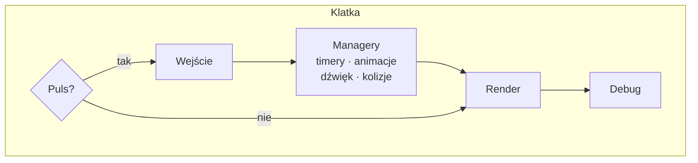

# Wnętrze silnika

Ten dział opisuje, **jak silnik działa pod spodem** — w odróżnieniu od działu [Silnik](../engine/index.md), który dotyczy języka skryptowego widzianego przez autora treści. Znajdziesz tu opis pętli gry, renderowania, systemu animacji oraz czasu i timerów, oparty na faktycznej implementacji Rex-EMoolatora i — tam, gdzie to możliwe — zestawiony z zachowaniem oryginalnego silnika.

## Jedna klatka w pigułce

Wszystko kręci się wokół jednej pętli wywoływanej raz na klatkę hosta. Rysowanie odbywa się w każdej klatce, a stan gry posuwają [pulsy silnika](loop.md#puls-silnika), wykonywane najwyżej 60 razy na sekundę. Diagram pokazuje kolejność z Pikliba 6.1–7.2; nowsze silniki przestawiają rysowanie.

## Rozdziały

-   :material-sitemap-outline:{ .lg .middle } __Architektura__

    ---

    Mapa całości: warstwy i moduły, centralny hub `Game`, managery, konteksty, system zmiennych i VFS oraz potok ładowania gry.

    [:octicons-arrow-right-24: Czytaj](architecture.md)

-   :material-sync:{ .lg .middle } __Pętla i zegar silnika__

    ---

    Pulsy silnika, zegar o zgrubnej rozdzielczości, kolejność faz zależna od wersji oraz pauza i krokowanie. Fundament, na którym opiera się reszta działu.

    [:octicons-arrow-right-24: Czytaj](loop.md)

-   :material-image-multiple:{ .lg .middle } __Renderowanie__

    ---

    Potok rysowania klatki, priorytety, odbicie osi Y, przycinanie i maski alfa — oraz jak render działał w oryginale (DirectDraw, dirty rects).

    [:octicons-arrow-right-24: Czytaj](rendering.md)

-   :material-crosshairs-gps:{ .lg .middle } __Współrzędne i kotwice__

    ---

    Kanwa 800×600, pozycjonowanie bezwzględne i względne, składanie pozycji animacji oraz kotwice (i ich nieintuicyjne odejmowanie).

    [:octicons-arrow-right-24: Czytaj](coordinates.md)

-   :material-animation-play:{ .lg .middle } __System animacji__

    ---

    Model zdarzeń i klatek, zegar odtwarzania, maszyna stanów (pętle, ping-pong, łańcuchy zdarzeń) i pozycjonowanie klatek.

    [:octicons-arrow-right-24: Czytaj](animation.md)

-   :material-timer-outline:{ .lg .middle } __Czas i timery__

    ---

    Jak `TIMER` liczy czas na zegarze silnika, logika sygnału `ONTICK` i pułapki metod `ENABLE`/`SET`/`SETELAPSE`.

    [:octicons-arrow-right-24: Czytaj](timers.md)

## Zobacz też

- [Formaty plików](../formats/index.md) — jak na dysku zakodowane są dane, które te systemy wczytują.
- [Referencja typów](../reference/index.md) — pełny spis obiektów dostępnych w skryptach.
