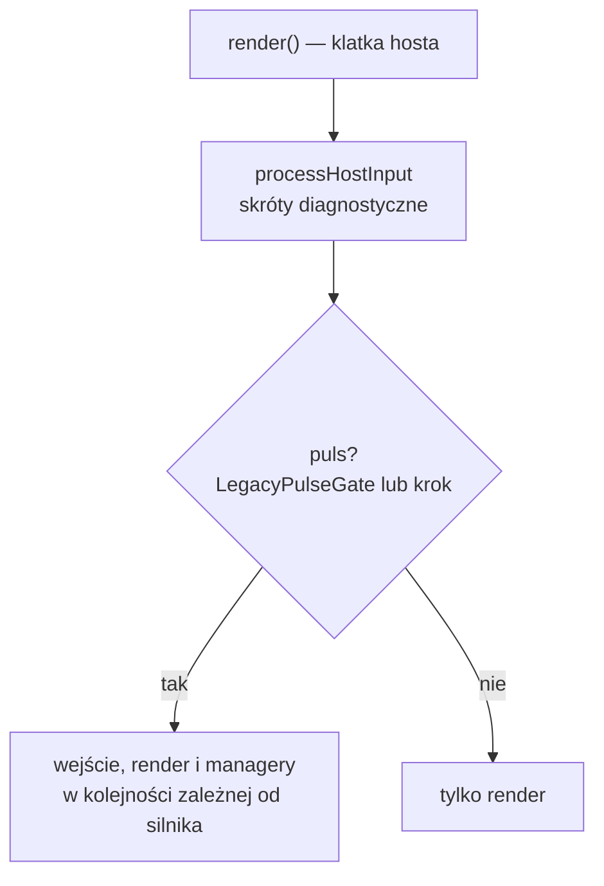

# Pętla i zegar silnika

Cała gra napędzana jest jedną pętlą: LibGDX wywołuje metodę `render()` raz na klatkę hosta. Stan gry nie jest jednak liczony „co klatkę”. Emulator odtwarza rytm oryginału: wykonuje **pulsy** silnika, a czas odczytuje z **zegara o zgrubnej rozdzielczości**, takiego jak `GetTickCount` w starych systemach. Ten rozdział opisuje oba mechanizmy oraz tryby pauzy i krokowania.

## Klatka hosta i puls silnika {#puls-silnika}

W pętli działają dwa niezależne rytmy:

| | Klatka hosta | Puls silnika |
|---|---|---|
| Tempo | wyznacza backend (`vsync`, `targetFPS = 60`) | najwyżej `legacyPulseHz = 60` razy na sekundę i najwyżej raz na klatkę |
| Zadania | skróty diagnostyczne, rysowanie, nakładka debug | wejście widoczne dla skryptów, timery, animacje, dźwięk, kolizje |
| Po zacięciu | nic do nadrobienia | pominięte pulsy przepadają |

Podział chroni skrypty przed wysokim odświeżaniem. Gdyby wejście i managery działały co klatkę, monitor 144 Hz przyspieszyłby powtarzanie klawiszy, obsługę ruchu myszy i stany przycisków.



O pulsie decyduje `LegacyPulseGate`. Pierwsze odpytanie przepuszcza od razu, a kolejne najwyżej raz na `1/60 s`. Spóźnione odpytanie przesuwa termin za bieżący czas, czyli **porzuca** zaległe pulsy zamiast je nadrabiać. Bramka jest rozstrzygająca, bo nie każdy backend respektuje `setForegroundFPS` (nie robi tego `AndroidGraphics`).

### Kolejność faz

Kolejność wejścia, rysowania i managerów jest widoczna dla skryptów i różni się między silnikami, dlatego trzyma ją `LegacyFrameOrder`, przypisany w [profilu kompatybilności](architecture.md#profil-kompatybilnosci):

| Silnik | Klatka z pulsem |
|---|---|
| Piklib 6.1, 7.1, 7.2 | wejście → managery → render |
| Piklib 8 | wejście → render → managery |
| BlooMoo, także w „Reksiu i Wehikule Czasu” | render → wejście → managery |

W klatce bez pulsu wykonuje się tylko render. Razem z nim zawsze rysuje się [nakładka debug](../emulator/index.md#skroty-klawiszowe).

## Praca wykonywana w pulsie

```java
public void pulse() {
    updateTimers();      // (1)
    updateAnimations();
    updateAudio();
    updateCollisions();  // (2)
}
```

1. [Timery](timers.md) i [animacje](animation.md) czytają czas z [zegara silnika](#zegar-silnika), a nie z licznika pulsów.
2. Kolizje są liczone tylko dla obiektów oznaczonych jako zmienione od ostatniego sprawdzenia.

Kolejność jest stała: **timery → animacje → dźwięk → kolizje**.

## Zegar silnika {#zegar-silnika}

`Game.getEngineTimeMs()` zwraca czas z `LegacyClock`: monotonicznego zegara w całych milisekundach, liczonego od startu gry. Implementacja `QuantizedLegacyClock` czyta `System.nanoTime()` i zaokrągla wynik w dół do kwantu, więc wartość przeskakuje skokami, tak jak `GetTickCount`. Zegar płynie w czasie rzeczywistym i nie zależy ani od liczby klatek, ani od liczby pulsów.

Kwant wybiera się osobno dla każdej gry (`LegacyClockProfile`):

| Profil | Kwant |
|---|---:|
| Windows 11 / 64 Hz (domyślny) | 15,625 ms |
| Windows XP / 100 Hz | 10 ms |
| QEMU / 86Box zmierzone w Windows 98 | 5 ms |
| Windows 9x, wartość nominalna | 54,9254 ms |
| 1 ms | 1 ms |

Profil opisuje cel zgodności, a nie system, na którym działa emulator.

!!! tip "Konsekwencja dla skryptów"
    [Timer](../reference/TIMER.md) ustawiony na `1000 ms` odpala się po sekundzie czasu rzeczywistego, z dokładnością do kwantu zegara i najbliższego pulsu, niezależnie od tego, czy gra chodzi w 30, czy w 240 FPS. Dwa uruchomienia mogą się jednak różnić o kilka milisekund, tak jak w oryginale.

!!! quote "Jak robił to oryginał"
    Schedulery oryginału porównują czas z `GetTickCount`: `CAnimationManager::domodal` jednym odczytem wybiera animacje, którym minął czas klatki, a `CXTimer` czyta zegar ponownie po wywołaniu obsługi timera. Rozdzielczość tego zegara zależy od systemu, stąd profile powyżej. Biblioteki silnika importują też `QueryPerformanceCounter` (klasa `CHiResTimer` — globalne `appTime`, `frameTime`, `fps`) oraz multimedialny `timeSetEvent`. Tempo 60 pulsów na sekundę to ustawienie emulatora.

## Pauza i krokowanie {#pauza-i-krokowanie}

Pętla obsługuje dwa tryby diagnostyczne sterowane przez `EngineConfig`:

| Tryb | Klawisz | Zachowanie |
|---|---|---|
| **Pauza** (`paused`) | `F11` | Pulsy nie są wykonywane, więc stan gry stoi. Klatki nadal się rysują, a skróty diagnostyczne działają. |
| **Krok** (`stepFrame`) | `F12` | Wymusza dokładnie **jeden** puls z pominięciem bramki. W pauzie pozwala przewijać grę puls po pulsie. |

!!! warning "Pauza diagnostyczna nie zatrzymuje zegara"
    `LegacyClock` płynie dalej, a pauza wstrzymuje tylko pulsy. Po jej zdjęciu timery i animacje, którym minął termin, wykonają się raz, bez nadrabiania. Pauzą sceny (`SCENE^PAUSE`) rządzą osobne reguły, opisane w [architekturze](architecture.md#zakres-leksykalny-a-zakres-odtwarzania).

## Powiązane tematy

- [Renderowanie](rendering.md) — co dzieje się w kroku „render”.
- [System animacji](animation.md) — jak animacje korzystają z zegara silnika.
- [Czas i timery](timers.md) — `TIMER` i sygnał `ONTICK`.
