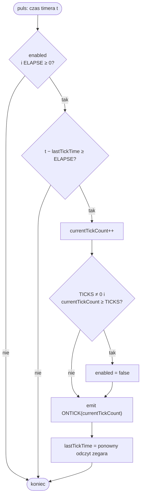

# Czas i timery

Obiekt [`TIMER`](../reference/TIMER.md#timer) to cykliczny licznik czasu: co zadany interwał emituje sygnał `ONTICK`, do którego skrypt podpina obsługę. Timery są podstawowym narzędziem do opóźnień, animowanych przejść sterowanych ze skryptu i powtarzalnych akcji. Ten rozdział opisuje, jak timery liczą czas i jak zachowują się ich metody.

## Czas mierzony zegarem silnika

Timery sprawdzane są w każdym [pulsie silnika](loop.md#puls-silnika), a czas odczytują z [zegara silnika](loop.md#zegar-silnika) o zgrubnej rozdzielczości, który płynie w czasie rzeczywistym. Dokładniej korzystają z `Game.getTimerTimeMs()`: to ten sam zegar pomniejszony o czas, przez który scena trzymała timery w pauzie.

!!! tip "Dokładność i pauza"
    Timer ustawiony na `1000 ms` tyka po sekundzie czasu rzeczywistego, z dokładnością do kwantu zegara (domyślnie 15,625 ms) i najbliższego pulsu, niezależnie od liczby klatek na sekundę. [`SCENE^PAUSE`](../reference/SCENE.md#pause) wstrzymuje czas timerów, chyba że wywołano ją jako `PAUSE(TRUE)`. [Pauza diagnostyczna](loop.md#pauza-i-krokowanie) wstrzymuje tylko pulsy, a zegar płynie dalej.

## Pola timera

| Pole | Znaczenie |
|---|---|
| `ELAPSE` | interwał między tyknięciami, w milisekundach |
| `TICKS` | maksymalna liczba tyknięć; `0` oznacza **bez limitu** |
| `enabled` | czy timer aktualnie tyka |
| `currentTickCount` | ile tyknięć już nastąpiło (wartość niesiona przez `ONTICK`) |
| `lastTickTime` | czas ostatniego tyknięcia (akumulator interwału) |

## Logika tyknięcia

W każdym pulsie silnik wywołuje `update()` na timerze:

Kluczowe szczegóły:

- na jeden puls przypada najwyżej jedno tyknięcie, więc spóźnione tyknięcia nie są nadrabiane,
- `lastTickTime` ustawiane jest dopiero **po** obsłudze `ONTICK`, ponownym odczytem zegara, więc czas wykonania obsługi nie wlicza się do kolejnego interwału,
- gdy licznik osiągnie dodatnie `TICKS`, timer wyłącza się **przed** ostatnią obsługą, dzięki czemu obsługa może go ponownie włączyć przez `ENABLE`,
- przy `TICKS = 0` timer tyka w nieskończoność, aż do `DISABLE`,
- przy `ELAPSE = 0` timer tyka w każdym pulsie.

!!! note "Ziarnistość"
    Sprawdzenie zachodzi raz na puls (zwykle co ~16,67 ms), a zegar przeskakuje o kwant profilu. Interwał jest więc w praktyce zaokrąglany w górę do pierwszego pulsu, w którym zegar pokaże przekroczenie progu.

## Metody i ich pułapki

Część metod ma zachowanie, które łatwo przeoczyć — zostało ono odwzorowane wprost z oryginalnego BlooMooDLL:

| Metoda | Działanie | Uwaga |
|---|---|---|
| [`ENABLE`](../reference/TIMER.md#enable) | włącza timer, zeruje licznik, restartuje okno interwału | **no-op, jeśli timer już jest włączony** — nie zeruje wtedy licznika |
| [`DISABLE`](../reference/TIMER.md#disable) | zatrzymuje tykanie | zachowuje `currentTickCount` |
| [`RESET`](../reference/TIMER.md#reset) | zeruje `currentTickCount` i restartuje okno interwału | nie zmienia `enabled` |
| [`SET`](../reference/TIMER.md#set) | ustawia `TICKS` **oraz** zeruje slot (licznik + okno) | nie tylko zmienia limit |
| [`SETELAPSE`](../reference/TIMER.md#setelapse) | zmienia `ELAPSE` | **zachowuje akumulator** (`lastTickTime`) — przestrojenie interwału w locie nie gubi już odliczonego czasu |
| [`GETTICKS`](../reference/TIMER.md#getticks) | zwraca `currentTickCount` | |

!!! warning "`ENABLE` na włączonym timerze nic nie robi"
    Jeśli chcesz zrestartować już tykający timer (wyzerować licznik i odliczanie), użyj [`RESET`](../reference/TIMER.md#reset) albo `DISABLE` + `ENABLE`. Samo `ENABLE` zostanie zignorowane.

## Czym różni się od oryginału

W `bloomoodll.dll` za timery odpowiadają klasy `CXTimer`/`CTimerNotificator`, a nie pętla renderowania. Rex-EMoolator sprawdza je zamiast tego w [pulsie silnika](loop.md#puls-silnika). Sama logika tyknięcia jest jednak ta sama: tak jak `CXTimer`, emulator czyta zegar ponownie po wywołaniu obsługi.

!!! quote "Potwierdzone dekompilacją"
    Metoda `CMC_Timer::onTimer` w oryginalnej bibliotece robi dokładnie to, co opisano wyżej: sprawdza flagę „włączony”, inkrementuje licznik tyknięć, wyłącza timer po osiągnięciu limitu `TICKS`, a następnie emituje sparametryzowany sygnał `ONTICK^<licznik>` oraz `ONTICK`.

## Powiązane tematy

- [`TIMER`](../reference/TIMER.md#timer) — referencja metod i sygnałów.
- [Pętla i zegar silnika](loop.md) — źródło czasu dla timerów.
- [Zdarzenia i sygnały](../engine/events.md) — jak `ONTICK` propaguje się przez drzewo wywołań.
