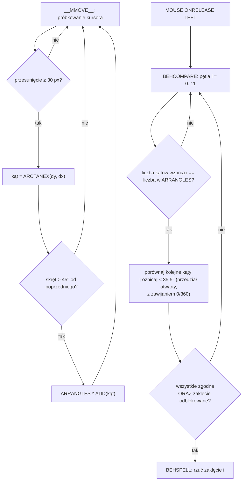
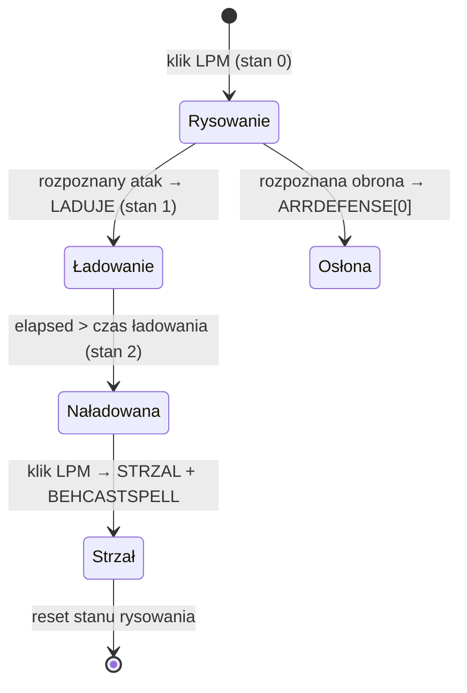

# Pojedynek zaklęć

Minigra pojedynku zaklęć (scena `Magic.cnv` w `Dane/Game/Przygoda/Magic`) pozwala „rysować" zaklęcia kursorem w powietrzu. Gracz kreśli gest z wciśniętym lewym przyciskiem myszy, a po jego zwolnieniu silnik próbuje **dopasować kształt do jednego ze znanych wzorców** i — jeśli się uda oraz zaklęcie jest odblokowane — rzuca je.

Cała logika jest napisana w skrypcie: jeden rozbudowany dyspozytor ze zdublowanymi procedurami i fragmentami martwego kodu (patrz [Błędy i relikty](#bledy-i-relikty-oryginalu)). Poniżej rozłożony jest na czynniki pierwsze; semantyka metod silnika, na których opiera się skrypt, została zweryfikowana dekompilacją `Piklib8.dll` — patrz [Kontrakty silnika](#kontrakty-silnika).

## Przegląd

Do pojedynku wchodzi się z przygody: zmienna globalna `S_IMAGICFIGHTER` wybiera rekord z bazy `$COMMON\FIGHTERS.DTA` (przeciwnik, miejsce, repertuar zaklęć, czas ładowania różdżki). Zakresy identyfikatorów uruchamiają różne warianty sceny:

| `S_IMAGICFIGHTER` | Wariant |
|---|---|
| `0–12` oraz `30` | zwykły pojedynek (dla `<13` lub `=30` przeciwnik atakuje sam z siebie) |
| `13–24` | lekcje samouczka (nauka konkretnych ataków i obron) |
| `25–29`, `31–39` | rekordy-wypełniacze (`NULL`) |
| `> 39` | tryb treningu: ćwiczone zaklęcie ma kod `S_IMAGICFIGHTER − 40` |

Wyjścia ze sceny: zwycięstwo i ukończony trening wracają do sceny `ARCADE` (z zapisem miejsca przez `S_SMAGICPLACE`), przegrana i ucieczka w trakcie zwykłej walki prowadzą do `LIMBO`.

## Model pojedynku

W grze istnieje **12 kodów zaklęć**: ataki `0–5` i odpowiadające im obrony `6–11` (obrona `k+6` neutralizuje atak `k`).

| Kod ataku | Zaklęcie       | Nauczyciel          | Kod obrony |
|----------:|----------------|---------------------|-----------:|
|         0 | Sen            | Gulgudryk Gryfindyk |          6 |
|         1 | Zamiana w żabę | Serpentus Snejk     |          7 |
|         2 | Plaga much     | Serpentus Snejk     |          8 |
|         3 | Kula budyniu   | Gulgudryk Gryfindyk |          9 |
|         4 | Koła i wiry    | Waldemar Mors       |         10 |
|         5 | Ciemność       | Waldemar Mors       |         11 |

Kluczowe zasady:

- **Nie ma punktów życia.** Każda ze stron ma sześć niezależnych liczników poziomu efektu (`ARREFFECTLEVEL0` dla Reksia, `ARREFFECTLEVEL1` dla przeciwnika). Trafienie atakiem podnosi odpowiedni licznik o 1.
- **Pojedynek kończy trzeci poziom *tego samego* efektu** — trzy trafienia różnymi zaklęciami niczego nie rozstrzygają. `VARIWINNER` przechowuje indeks strony *pokonanej* (`1` = przegrał przeciwnik, czyli wygrał Reksio).
- Gracz może rzucać tylko zaklęcia **odblokowane**: flagi `ARRACTIVESPELLS[0..11]` kopiowane przy starcie z globalnej tablicy `G_ARRREXSPELLS[0..11]` (trwały postęp — patrz [Tutorial](#tutorial-trening-i-zapis-postepu)).
- Przeciwnik nie rysuje „naprawdę" — odtwarza gotową choreografię i nie przechodzi rozpoznawania kształtu (patrz [Przeciwnicy i AI](#przeciwnicy-i-ai)).

## Sterowanie: wirtualny kursor

Scena nie używa bezpośrednio pozycji systemowej myszy. `MOUSE:ONMOVE` realizuje sterowanie **względne**:

1. Liczy deltę od punktu kotwicy: `dx = mouseX − 400`, `dy = mouseY − 300`.
2. Dzieli ją przez `ARRSPEEDFACTOR[0]` (rośnie pod wpływem budyniu — kursor zwalnia).
3. Dodaje wynik do pozycji wirtualnego kursora `VARICURSORX/Y`; do składowej Y dochodzi jednorazowy skok `ARRJUMP[0]` (efekt żaby).
4. Ogranicza pozycję do `[0,800] × [0,600]` (`CLAMP`).
5. Przesuwa graficzny `G_CURSOR` bez wywoływania jego callbacków i **centruje systemową mysz z powrotem na `(400,300)`**.

Dzięki temu gracz może „pchać" kursor w nieskończoność, nie dobijając do krawędzi ekranu. Skrypt zawiera też obsługę zakłóceń wirtualnego kursora od aktywnych efektów:

- **wiry** — zegar `STL8` dodaje sinusoidalny dryf o amplitudzie `ARRSLIDE[0]`;
- **muchy** — jeśli pod kursorem (zakres priorytetów `40..40`) znajdzie się animacja muchy, kursor jest do niej przyciągany przez kilka klatek;
- **sen** — rysowanie jest przerywane, a różdżka opada (`ZWISA`), dopóki głowa odtwarza event `SPI`.

Podczas rysowania każde zdarzenie ruchu przesuwa dodatkowo klatkę animacji różdżki o `0.1` (`BFITMP46` — różdżka płynnie „kreśli"), po czym jawnie wywołuje `__MMOVE__^RUN()`.

## Rozpoznawanie gestów

### Dwie reprezentacje zaklęcia

Zaklęcie występuje w skryptach w **dwóch niezależnych postaciach**, które łatwo pomylić.

=== "Sekwencja kątów — do rozpoznawania"

    Tablice `ARRPATTERN0..11` to zaszyte na sztywno **ciągi kątów kierunku** (głównie na siatce co 45°), dodawane w `__INIT__`. To **z nimi** porównywany jest gest gracza. Wejście gracza **nie** jest zestawiane z chmurami punktów.

=== "Chmura punktów — tylko do odtwarzania"

    Pliki `spellN_0.arr` / `spellN_1.arr` (oraz `tut_*`, `spell_pent/n/nb/box`) to równoległe listy współrzędnych **X** i **Y** łamanej — patrz [format ARR](../formats/ARR.md). Służą **wyłącznie do odtwarzania**: renderują gest jako ślad klonów, gdy zaklęcie rzuca przeciwnik albo pokazuje je samouczek. Ładuje je `BEHLOADSPELL` (`$1+"0.ARR"` → `ARRENEMYROUTEX`, `$1+"1.ARR"` → `ARRENEMYROUTEY`).

!!! warning "Nie rozpoznajemy po chmurze punktów"
    Najczęstszy błąd przy czytaniu tych skryptów: wygląda na to, że gest gracza jest porównywany z zapisanymi trasami `.arr`. Tak nie jest. Trasy `.arr` to grafika (ślad zaklęcia), a rozpoznawanie działa na **sekwencji kątów** w `ARRPATTERN`.

### Od gestu do sekwencji kątów (`ARRANGLES`)

Rysowanie zaczyna kliknięcie lewym przyciskiem (gdy żaden czar nie jest naładowany): skrypt czyści `ARRROUTEX/Y` i `ARRANGLES`, ustawia `VARDLASTTAN = −1` i włącza tryb rysowania (`VARIDOMAGIC = 1`). W trakcie rysowania behaviour `__MMOVE__` redukuje ślad kursora do sekwencji „narożnikowych" kierunków w tablicy `ARRANGLES`:

1. Segment jest **ignorowany**, dopóki kursor nie przesunie się o co najmniej **30 px** od ostatniej *zaakceptowanej* próbki (`LENGTH < 30 → @BREAK`). To odsiewa drżenie ręki; dystans akumuluje się od ostatniego przyjętego punktu, nie od poprzedniego zdarzenia myszy.
2. Kierunek segmentu to `ARCTANEX(dy, dx)` — `atan2` zwracające **stopnie 0–360**. Oś Y kanwy jest skierowana **w dół** (patrz [Współrzędne i kotwice](../internals/coordinates.md)), więc kodowanie kierunków wygląda tak:

<svg viewBox="0 0 300 210" role="img" aria-label="Kodowanie kierunków: 0°=w prawo, 90°=w dół, 180°=w lewo, 270°=w górę, przy osi Y skierowanej w dół" xmlns="http://www.w3.org/2000/svg" style="max-width:320px;width:100%;height:auto">
  <defs>
    <marker id="ah-dir" markerWidth="9" markerHeight="9" refX="6" refY="3" orient="auto">
      <path d="M0,0 L6,3 L0,6 Z" fill="currentColor"/>
    </marker>
  </defs>
  <!-- 8 spokes from center (150,105), r=60 -->
  <line x1="150" y1="105" x2="210" y2="105" stroke="currentColor" stroke-width="1.5" marker-end="url(#ah-dir)"/>
  <line x1="150" y1="105" x2="192" y2="147" stroke="currentColor" stroke-width="1.5" marker-end="url(#ah-dir)"/>
  <line x1="150" y1="105" x2="150" y2="165" stroke="currentColor" stroke-width="1.5" marker-end="url(#ah-dir)"/>
  <line x1="150" y1="105" x2="108" y2="147" stroke="currentColor" stroke-width="1.5" marker-end="url(#ah-dir)"/>
  <line x1="150" y1="105" x2="90"  y2="105" stroke="currentColor" stroke-width="1.5" marker-end="url(#ah-dir)"/>
  <line x1="150" y1="105" x2="108" y2="63"  stroke="currentColor" stroke-width="1.5" marker-end="url(#ah-dir)"/>
  <line x1="150" y1="105" x2="150" y2="45"  stroke="currentColor" stroke-width="1.5" marker-end="url(#ah-dir)"/>
  <line x1="150" y1="105" x2="192" y2="63"  stroke="currentColor" stroke-width="1.5" marker-end="url(#ah-dir)"/>
  <text x="216" y="108" font-size="11" fill="currentColor" text-anchor="start">0° →</text>
  <text x="196" y="162" font-size="11" fill="currentColor" text-anchor="start">45° ↘</text>
  <text x="150" y="180" font-size="11" fill="currentColor" text-anchor="middle">90° ↓</text>
  <text x="104" y="162" font-size="11" fill="currentColor" text-anchor="end">135° ↙</text>
  <text x="84"  y="108" font-size="11" fill="currentColor" text-anchor="end">180° ←</text>
  <text x="104" y="58"  font-size="11" fill="currentColor" text-anchor="end">225° ↖</text>
  <text x="150" y="38"  font-size="11" fill="currentColor" text-anchor="middle">270° ↑</text>
  <text x="196" y="58"  font-size="11" fill="currentColor" text-anchor="start">315° ↗</text>
</svg>

3. Nowy kierunek trafia do `ARRANGLES` **tylko wtedy, gdy skręt względem poprzedniego przekracza 45°** w sensie kołowym (warunek `45 < |Δ| < 315`; różnice z przedziału `[315°, 360°)` to małe skręty przez 0°). Pierwszy segment jest wymuszany (różnica ustawiana na 46°). Prosty odcinek daje więc **jeden** kąt, a każdy ostry narożnik dokłada kolejny.
4. Niezależnie od tego, czy kąt został dodany, punkt trafia do `ARRROUTEX/Y` (wizualny ślad do późniejszego odtworzenia), a za kursorem podąża jedna z 10 cyklicznych cząstek różdżki (klony `ANNMAGIC`).

Efekt: gest zostaje sprowadzony do krótkiej listy kierunków, np. „w górę, w prawo-dół, w górę, w lewo-dół, w prawo". `ARRROUTEX/Y` ma zwykle więcej punktów niż `ARRANGLES` — pierwsze to grafika, drugie to zredukowany opis narożników.

### Dopasowanie do wzorca

Po zwolnieniu przycisku uruchamiany jest komparator:

1. Wyzwalacz: `MOUSE:ONRELEASE^LEFT → BFITMP61 → BEHCOMPARE^RUN()`.
2. `BEHCOMPARE` iteruje `i = 0..11` **w tej kolejności** — wygrywa pierwszy pasujący wzorzec. Porównanie kąt-po-kącie odpala **tylko gdy `GETSIZE(ARRPATTERNi) == GETSIZE(ARRANGLES)`** — czyli gdy liczba narożników zgadza się dokładnie.
3. `BEHCOMPPATTERN` + `BFITMP114`: każdy narysowany kąt musi mieścić się w **otwartym przedziale `wzorzec ± 35,5°`** (ścisłe `>` i `<` — wartość dokładnie na granicy odpada), z pełną obsługą zawinięcia przez 0/360 (cała drabinka `BFITMP104..113` to tylko przypadki „dolna granica < 0" / „górna ≥ 360" / „środek"). Pierwsze niedopasowanie ustawia flagę i przerywa.
4. `BFITMP119`: pełne trafienie wymaga `liczba_dopasowanych == długość_wzorca` **oraz** `ARRACTIVESPELLS[i] == 1` (zaklęcie odblokowane) → `BEHSPELL^RUN()` rzuca. Indeksy 0–5 to atak, 6–11 to obrona (`BEHSPELL` rozgałęzia się na `> 5`).

Rozpoznawanie ignoruje: pozycję startową, skalę rysunku, długości odcinków i proporcje — liczy się wyłącznie **ciąg kierunków**, o ile każdy potrzebny odcinek osiągnie 30 px.

!!! tip "Tolerancja jest hojna"
    Tolerancja ±35,5° na siatce kątów co 45° oznacza, że sąsiednie kierunki nachodzą na siebie niemal stykiem — gest nie musi być precyzyjny, byle zgadzał się **ciąg** narożników.

!!! example "Symulator rozpoznawania"
    Algorytm można wypróbować w [interaktywnym symulatorze](duel-shape-recognize.html){target=_blank} — rysowanie gestu pokazuje na żywo próbkowanie co 30 px, wykryte narożniki i przebieg porównania z każdym z 12 wzorców.

## Katalog zaklęć

Kolejność w `ARRCOMPSPELLS` odpowiada indeksowi wzorca `ARRPATTERN`. Kierunki zdekodowano wg kodowania z sekcji wyżej. Pliki ataków `SPELL0_`–`SPELL5_` przechowują choreografię **przeciwnika stojącego naprzeciw Reksia**, dlatego ich surowe trasy są poziomym lustrzanym odbiciem wzorców gracza; miniatury 0–5 odbito z powrotem. Trasy obron 6–11 są już zapisane z perspektywy gracza i pozostają nieodbite. Wszystkie miniatury pokazują trasę demonstracji, a nie dane używane bezpośrednio przez komparator. **Grot oznacza koniec trasy i wskazuje kierunek kreślenia.**

<svg xmlns="http://www.w3.org/2000/svg">
  <defs>
    <marker id="spell-trace-arrow" markerWidth="14" markerHeight="14" refX="13" refY="7" orient="auto" markerUnits="userSpaceOnUse">
      <path d="M0,0 L14,7 L0,14 Z" fill="currentColor"/>
    </marker>
    <g id="spell-trace-0"><polyline points="103.75,74 103.75,57 103.75,42 103.25,27 102.25,12 85.75,24 71.25,37.5 61.25,49 45.25,48 34.25,34 26.25,20.5 20.75,6 16.25,22 16.25,39.5 16.25,54.5 16.25,71"/></g>
    <g id="spell-trace-1"><polyline points="92.65,17.59 93.42,29.18 93.81,42.32 93.81,54.3 94.19,66.27 84.15,72.45 69.85,72.84 57.1,72.84 44.74,74 33.15,74 30.44,60.48 30.06,46.95 30.06,33.82 28.51,21.84 25.81,8.32 38.56,6 53.63,6.77 65.6,6.77 77.97,6.77 72.94,18.75 64.06,26.86 52.47,34.2 61.35,44.64 71.4,50.82 81.44,57.39"/></g>
    <g id="spell-trace-2"><polyline points="58.32,6 58.65,17.78 58.99,30.24 58.99,41.01 58.99,51.78 58.65,63.9 58.65,74 66.06,66.26 73.13,58.51 79.19,50.44 86.26,42.02 76.5,35.29 65.39,34.95 53.94,34.61 43.84,32.93 33.74,33.6 36.77,23.84 44.18,15.43 54.28,7.35"/></g>
    <g id="spell-trace-3"><polyline points="27.8,7.55 43.77,7.55 61.29,6 76.74,6.52 92.2,7.03 99.41,23 89.62,36.39 74.17,36.91 57.17,35.88 41.71,35.88 25.74,35.36 20.59,52.88 21.11,68.33 36.56,74 54.59,74 72.62,74 89.62,73.48"/></g>
    <g id="spell-trace-4"><polyline points="93.07,65.15 92.14,50.71 92.6,36.27 92.14,19.97 89.81,6 79.1,17.18 70.71,29.29 61.4,40.47 51.62,51.64 40.9,62.82 30.66,74 27.86,56.3 27.86,40.93 27.4,26.03 26.93,12.05 38.11,22.3 49.29,33.95 60.47,45.59 72.11,54.9 82.36,65.62 68.38,72.14 53.48,71.21 39.51,70.27"/></g>
    <g id="spell-trace-5"><polyline points="90.91,73.59 78.55,74 64.95,73.59 50.93,74 37.75,73.18 45.99,63.7 55.47,53.81 64.95,45.15 62.47,32.38 51.35,24.96 39.39,18.36 29.09,11.36 41.45,6 56.29,6 69.48,6 83.08,6.41"/></g>
    <g id="spell-trace-6"><polyline points="40.88,7.18 48.9,6.94 56.69,6.71 65.67,6.71 72.75,6.47 80.31,6 85.97,10.72 85.97,18.99 85.97,27.25 85.97,35.04 86.68,43.31 86.68,51.81 86.68,59.83 85.74,66.92 85.74,74 78.42,73.53 70.86,73.29 62.13,73.29 55.04,73.29 46.54,73.53 38.28,73.29 33.32,67.86 33.56,60.54 34.03,52.99 34.03,45.43 34.5,38.11 44.18,35.04 52.21,36.22 59.29,36.22 68.74,36.22 75.82,35.99"/></g>
    <g id="spell-trace-7"><polyline points="13.96,46.02 12.66,36.26 11.68,23.24 11.03,12.51 21.12,6 30.88,6 41.62,6 51.38,6 53.66,16.41 54.31,27.8 54.31,38.54 54.31,50.25 54.31,61.31 54.31,71.07 66.34,74 79.36,73.35 90.1,72.37 100.83,72.7 107.67,64.89 107.99,55.13 107.99,43.74 108.97,31.7 108.64,19.34 107.99,9.58 97.9,9.25 88.14,17.06 74.48,25.2 60.16,40.16 48.45,48.95 39.34,58.38 30.23,66.52 21.44,72.7"/></g>
    <g id="spell-trace-8"><polyline points="94.94,30.2 89.1,26.44 83.67,23.1 77,18.52 71.79,14.55 66.36,10.38 59.9,6 53.85,8.92 49.47,13.93 43.42,20.39 38.41,24.56 33.4,29.36 29.65,34.99 25.06,39.37 30.9,45.21 38.2,50.22 43.83,55.23 49.05,58.98 54.68,64.61 59.69,69.2 63.86,74 68.45,68.99 71.37,63.36 76.17,59.19 81.17,54.81 86.18,49.39 90.77,43.75"/></g>
    <g id="spell-trace-9"><polyline points="113.67,67.67 113.33,56 113.33,44.33 114,34 114,23 102.67,19.33 86.67,19.67 76.67,19.67 70.33,31 69.67,45.67 69.33,61.33 69.67,72 59.67,71 48.67,69 35,67 21,65.33 9,65.33 6,55.33 7,39.33 7.67,28.67 7.67,18 7.67,8"/></g>
    <g id="spell-trace-10"><polyline points="61.47,30.9 66.83,37.06 71.91,44.55 79.14,54.99 88.78,66.77 92.8,73.73 81.55,74 73.52,73.46 63.35,73.2 53.98,72.39 45.94,72.66 36.57,72.66 27.2,72.66 35.5,57.94 46.48,45.89 51.83,39.73 60.94,32.77 68.97,25.01 76.2,18.31 84.76,12.16 91.19,7.07 80.48,6 70.84,6 58.26,6 48.62,6 38.18,6"/></g>
    <g id="spell-trace-11"><polyline points="86.12,6 78.48,6 70.59,6 61.23,6 53.35,6.25 44.72,6.49 36.35,6 28.96,6.25 35.36,15.86 40.29,22.26 45.96,29.41 50.88,35.57 58.28,41.48 53.84,50.35 47.19,56.26 39.8,61.43 30.19,70.3 38.07,74 46.45,73.75 54.09,73.01 62.22,73.01 70.84,73.01 80.7,73.01 91.04,73.26"/></g>
  </defs>
</svg>

| # | Zaklęcie | Wzorzec (kąty) | Kierunki | Trasa z `.arr` | ID `.arr` (odtwarzanie) | Typ |
|---:|---|---|---|---|---|---|
| 0 | Sen | 270, 45, 315, 90 | ↑ ↘ ↗ ↓ | <svg viewBox="0 0 120 80" role="img" aria-label="Trasa zaklęcia Sen" style="width:120px;height:80px"><use href="#spell-trace-0" fill="none" stroke="currentColor" stroke-width="3.5" stroke-linecap="round" stroke-linejoin="round"></use></svg> | `SPELL0_` | atak |
| 1 | Zamiana w żabę | 90, 0, 270, 180, 45, 135 | ↓ → ↑ ← ↘ ↙ | <svg viewBox="0 0 120 80" role="img" aria-label="Trasa zaklęcia Zamiana w żabę" style="width:120px;height:80px"><use href="#spell-trace-1" fill="none" stroke="currentColor" stroke-width="3.5" stroke-linecap="round" stroke-linejoin="round"></use></svg> | `SPELL1_` | atak |
| 2 | Plaga much | 90, 225, 0, 225 | ↓ ↖ → ↖ | <svg viewBox="0 0 120 80" role="img" aria-label="Trasa zaklęcia Plaga much" style="width:120px;height:80px"><use href="#spell-trace-2" fill="none" stroke="currentColor" stroke-width="3.5" stroke-linecap="round" stroke-linejoin="round"></use></svg> | `SPELL2_` | atak |
| 3 | Kula budyniu | 180, 90, 0, 90, 180 | ← ↓ → ↓ ← | <svg viewBox="0 0 120 80" role="img" aria-label="Trasa zaklęcia Kula budyniu" style="width:120px;height:80px"><use href="#spell-trace-3" fill="none" stroke="currentColor" stroke-width="3.5" stroke-linecap="round" stroke-linejoin="round"></use></svg> | `SPELL3_` | atak |
| 4 | Koła i wiry | 270, 45, 270, 135, 0 | ↑ ↘ ↑ ↙ → | <svg viewBox="0 0 120 80" role="img" aria-label="Trasa zaklęcia Koła i wiry" style="width:120px;height:80px"><use href="#spell-trace-4" fill="none" stroke="currentColor" stroke-width="3.5" stroke-linecap="round" stroke-linejoin="round"></use></svg> | `SPELL4_` | atak |
| 5 | Ciemność | 0, 225, 315, 180 | → ↖ ↗ ← | <svg viewBox="0 0 120 80" role="img" aria-label="Trasa zaklęcia Ciemność" style="width:120px;height:80px"><use href="#spell-trace-5" fill="none" stroke="currentColor" stroke-width="3.5" stroke-linecap="round" stroke-linejoin="round"></use></svg> | `SPELL5_` | atak |
| 6 | Obrona przed Snem | 0, 90, 180, 270, 0 | → ↓ ← ↑ → | <svg viewBox="0 0 120 80" role="img" aria-label="Trasa obrony przed Snem" style="width:120px;height:80px"><use href="#spell-trace-6" fill="none" stroke="currentColor" stroke-width="3.5" stroke-linecap="round" stroke-linejoin="round"></use></svg> | `TUT_SLEEPDEF_` | obrona |
| 7 | Obrona przed Żabą | 280, 0, 90, 0, 270, 135 | ↑ → ↓ → ↑ ↙ | <svg viewBox="0 0 120 80" role="img" aria-label="Trasa obrony przed Żabą" style="width:120px;height:80px"><use href="#spell-trace-7" fill="none" stroke="currentColor" stroke-width="3.5" stroke-linecap="round" stroke-linejoin="round"></use></svg> | `TUT_FROGDEF_` | obrona |
| 8 | Obrona przed Muchami | 225, 135, 45, 315, 180 | ↖ ↙ ↘ ↗ ← | <svg viewBox="0 0 120 80" role="img" aria-label="Trasa obrony przed Muchami" style="width:120px;height:80px"><use href="#spell-trace-8" fill="none" stroke="currentColor" stroke-width="3.5" stroke-linecap="round" stroke-linejoin="round"></use></svg> | `TUT_FLIESDEF_`[^typo] | obrona |
| 9 | Obrona przed Budyniem | 270, 180, 90, 180, 270 | ↑ ← ↓ ← ↑ | <svg viewBox="0 0 120 80" role="img" aria-label="Trasa obrony przed Budyniem" style="width:120px;height:80px"><use href="#spell-trace-9" fill="none" stroke="currentColor" stroke-width="3.5" stroke-linecap="round" stroke-linejoin="round"></use></svg> | `TUT_PUDDINGDEF_` | obrona |
| 10 | Obrona przed Wirami | 45, 180, 315, 180 | ↘ ← ↗ ← | <svg viewBox="0 0 120 80" role="img" aria-label="Trasa obrony przed Wirami" style="width:120px;height:80px"><use href="#spell-trace-10" fill="none" stroke="currentColor" stroke-width="3.5" stroke-linecap="round" stroke-linejoin="round"></use></svg> | `TUT_WHIRLSDEF_` | obrona |
| 11 | Obrona przed Ciemnością | 180, 45, 135, 0 | ← ↘ ↙ → | <svg viewBox="0 0 120 80" role="img" aria-label="Trasa obrony przed Ciemnością" style="width:120px;height:80px"><use href="#spell-trace-11" fill="none" stroke="currentColor" stroke-width="3.5" stroke-linecap="round" stroke-linejoin="round"></use></svg> | `TUT_DARKDEF_` | obrona |

[^typo]: W skrypcie faktycznie zapisano `TUT_FIESDEF_` — literówka bez litery `L`; patrz [Błędy i relikty](#bledy-i-relikty-oryginalu).

Wzorzec 7 naprawdę zaczyna się od `280` — to nie błąd transkrypcji.

Oprócz powyższych na dysku są ślady **tylko do odtwarzania**, bez własnego wzorca rozpoznawania: `tut_sleep_`..`tut_dark_` (pokazowe rzuty przeciwnika w samouczku) oraz `spell_pent`, `spell_n`, `spell_nb`, `spell_box` (kształty prototypowe — kolejno pentagram, zygzak, podwójna fala, ramka; `spell_nb` i `spell_box` nie są używane przez żadną z dwóch scen).

## Rzucanie czaru i obrona gracza

Rozpoznany **atak** (kod 0–5) nie działa od razu — przechodzi przez maszynę stanów `VARISPELLREADY`:

1. `BEHSPELL` odtwarza cały zapisany ślad (`ARRROUTEX/Y`) klonami `ANNSPELL_n` i uruchamia animację ładowania `ANNWAND0:LADUJE`.
2. Każda zmiana klatki `LADUJE` inkrementuje `ARRTIMEELAPSED[0]`. Warunek gotowości jest **ścisły** (`elapsed > czas`), więc potrzeba `czas + 1` callbacków; czas ładowania gracza to `G_ARRREXSPELLS[12]`.
3. W stanie „naładowana" kolejne kliknięcie odpala `STRZAL` i `BEHCASTSPELL`: pod kursorem wykonywany jest **pikselowy hit-test** `GETGRAPHICSAT(x, y, TRUE, 10, 20, FALSE)` — parametry `10, 20` to zakres **priorytetów** obejmujący części przeciwnika (korpus 10, głowa 15, szaty bossa 17, różdżka 20), a `FALSE` wymusza test rzeczywistego nieprzezroczystego piksela. Trafienie w cokolwiek spoza `ARRENEMYPARTS` **zużywa strzał bez efektu**.
4. Trafienie: chmura `ANNCLOUD` na przeciwniku i `BEHAPPLYSPELL(1, kod)` — podniesienie poziomu efektu (patrz niżej).

Rozpoznana **obrona** (kod 6–11) nie ma fazy ładowania: skrypt zapisuje `ARRDEFENSE[0] = kod − 6` i pokazuje tarczę `ANNSHIELD`. Obrona jest:

- **typowana** — neutralizuje wyłącznie atak o dopasowanym kodzie,
- **jednorazowa** — po zbiciu ataku znika (`ARRDEFENSE[0] = −1`),
- **bezterminowa** — nie wygasa z czasem; nietrafiony typ ataku przechodzi mimo tarczy, a tarcza zostaje.

## Efekty i timery

`BEHAPPLYSPELL(cel, kod)` najpierw sprawdza osłonę (`ARRDEFENSE[cel] == kod` → atak zbity), w przeciwnym razie — dla kodów ataku 0–5 — podnosi `ARREFFECTLEVEL{cel}[kod]` i uruchamia obsługę efektu (kody 6–11 nie mają gałęzi w dyspozytorze i nie robią nic). Poziom 3 kończy pojedynek. Efekty działają na obie strony, ale objawy są różne:

| Kod | Efekt          | U Reksia                                                                                                                                                                                                            | U przeciwnika                                                               |
|----:|----------------|---------------------------------------------------------------------------------------------------------------------------------------------------------------------------------------------------------------------|----------------------------------------------------------------------------------------------|
|   0 | Sen            | co 20 sekund usypia: rysowanie przerwane, głowa `SPI`, różdżka `ZWISA`; pobudka po `1,875·poziom` sekundach                                                                                                         | analogiczny cykliczny sen różdżki i AI                                                       |
|   1 | Zamiana w żabę | animacja żabich cech ciała; zamierzony skok kursora co `2,5 ÷ poziom` sekund o `20·poziom` px **nie uruchamia się** przez źle postawioną `*` przy ustawianiu timera                                                 | animacja + `10%·poziom` szansy przerwania każdego kroku kreślenia                            |
|   2 | Plaga much     | poziom 1: 2 muchy latające po ekranie, poziom 2: 5; zamierzone porywanie kursora nie działa po intro, bo `STL8` zostaje zatrzymany (a piąta mucha ma dodatkowo zły priorytet); poziom 3 przyspiesza muchy do 30 fps | 1–3 muchy przy głowie + `15%·poziom` szansy przerwania kreślenia                             |
|   3 | Kula budyniu   | `ARRSPEEDFACTOR ×2` za trafienie — kursor zwalnia 2×, potem 4× (trzecie trafienie kończy pojedynek)                                                                                                                 | zegar kreślenia `STLMAGIC` zwalnia z 5 do `5 − poziom` fps (-20% wartości bazowej na poziom) |
|   4 | Koła i wiry    | `ARRSLIDE += 3` za poziom, ale zamierzony sinusoidalny dryf kursora nie działa po intro przez zatrzymany `STL8`                                                                                                     | `20%·poziom` szansy, że wystrzelony atak spudłuje                                            |
|   5 | Ciemność       | narastające zaciemnienie ekranu (`ANNDARK0`)                                                                                                                                                                        | `15%·poziom` szansy spudłowania ataku                                                        |

!!! note "Cykl snu w szczegółach"
    Timer efektu snu (`STLEFFECT0_x`) działa w pętli: `elapsed == 0` → zaśnięcie, `elapsed == 30·poziom` → pobudka, przy `elapsed == 320` licznik jest ustawiany na `−1`, a bezwarunkowa inkrementacja w tym samym callbacku daje `0` — kolejny callback zaczyna więc cykl od nowa. Sen wraca falami do końca pojedynku.

!!! note "Wspólne losowanie"
    Testy pudła od wirów i ciemności po stronie przeciwnika używają **jednej** wylosowanej liczby 0–99 — nie są niezależnymi rzutami.

Po rozstrzygnięciu (`VARIWINNER` ustawiony) zegar `STL10` odlicza `VARITIMETOEXIT` od 5 do 0, po czym gra odtwarza sekwencję zwycięstwa (zależną od typu przeciwnika; boss ma dwuetapową) albo porażki i wraca odpowiednio do `ARCADE` / `LIMBO`.

## Przeciwnicy i AI

### Baza `fighters.dta`

`$COMMON\FIGHTERS.DTA` to **tekstowa** baza rekordów `ID|PLACE|TYPE|SPELLS|TIME` (separator `|`, wiersze CRLF), ładowana przez obiekt `DATABASE` z modelem `STRUCT` — patrz [`DATABASE`](../reference/DATABASE.md). Pole `SPELLS` to kody rozdzielone `_`; kody `≤5` trafiają do `ARRFIGHTERSPELLS` (ataki), `>5` do `ARRFIGHTERDEFENSE` (obrony). `TIME` to czas ładowania różdżki przeciwnika (im mniejszy, tym groźniejszy). `TYPE` wybiera komplet animacji: `−1` Ten, Który Tak Potwornie Mąci (boss, dodatkowe szaty i podmienione dźwięki), `0` gęś, `1` kura, `2` drwal, `3` lew, `4` strach na wróble.

| ID | Miejsce | Typ | Zaklęcia | Czas ładowania |
|---:|---|---:|---|---:|
| 0 | `MIASTO_PRZYSTAN` | gęś | 3 | 80 |
| 1 | `MIASTO_MIOTLISKO` | gęś | 3, 6, 9 | 64 |
| 2 | `DOMALCHOMIKA` | gęś | 3, 6 | 80 |
| 3 | `PIKMIOT` | gęś | 0, 3, 6, 9 | 48 |
| 4 | `UNIVPIWNICA` | gęś | 0, 3, 6, 9 | 64 |
| 5 | `UNIVFRONT` | gęś | 0, 3, 6, 9, 1 | 32 |
| 6 | `MIOTLISKO` | gęś | 1, 3, 6, 9, 5, 8 | 32 |
| 7 | `PRZEDSEZAMEM` | kura | 0, 2, 5, 6, 7, 8, 9 | 16 |
| 8 | `NORASZ` | kura | 1, 2, 5, 6, 7, 8, 9 | 16 |
| 9 | `BARANMIOT` | kura | 6, 9, 5, 8, 2 | 16 |
| 10 | `KORYTARZ` | kura | 0, 1, 2, 4, 5, 6, 7, 8, 9 | 16 |
| 11 | `WMWEJSCIE` | kura | 1, 2, 3, 5, 7, 8, 9, 10, 11 | 16 |
| 12 | `GABINETDYR` | kura | 1, 2, 3, 4, 5, 6, 7, 8, 9, 10 | 16 |
| 30 | `POMPA` | boss | 0–11 (komplet) | 8 |

### Wybór zaklęcia

`BEH_AI_BESTSPELL` wybiera ruch przeciwnika:

1. Sumuje poziomy efektów nałożonych na Reksia i zapamiętuje najsilniej rozwinięty.
2. Losuje 0–99; z szansą 49% (`> 50`) rozważa **obronę**: szuka własnego efektu na poziomie dokładnie 2 (krok od przegranej), zamienia jego kod na `+6` i sprawdza, czy ma taką obronę w repertuarze.
3. W gałęzi ofensywnej: jeśli Reksio nie ma żadnych efektów — losowy atak z repertuaru; w przeciwnym razie próbuje **dobić** najsilniejszy efekt tym samym zaklęciem.

### Kreślenie i strzał

Wybrany kod wskazuje prefiks w `ARRCOMPSPELLS`; `BEHLOADSPELL` ładuje trasę z pary plików `.arr`, a zegar `STLMAGIC` (bazowo 5 fps) w każdym callbacku zdejmuje **jeden punkt** trasy i stawia w nim cząstkę — przeciwnik „rysuje" wzór punkt po punkcie. Każdy krok może zostać przerwany przez żabę/muchy (patrz tabela wyżej). Po opróżnieniu trasy skrypt odtwarza pełny ślad, ładuje różdżkę (`SFIGHTER|TIME + 1` callbacków) i strzela; pudła od wirów/ciemności rozstrzygają się w momencie strzału.

!!! danger "Pętla po skumulowaniu różnych efektów"
    Ponieważ pojedynek kończy dopiero trzeci poziom **jednego** efektu, można nałożyć przeciwnikowi po 1–2 poziomy kilku różnych zaklęć i nadal walczyć. Sen zatrzymuje jego rysowanie okresowo, a żaba i muchy mogą kasować każdy kolejny punkt trasy. Oryginalne procedury przerwania wykonują na `STLMAGIC` sekwencję `STOP(FALSE)`, czyszczą trasę i przez `BEHDOSPELL` niemal natychmiast wywołują ponownie `PLAY("ELAPSE")`. Przy częstych przerwaniach timer jest więc restartowany z wnętrza własnego łańcucha callbacków; w Piklib8 może utknąć w ponownych wejściach i przeciwnik przestaje być zdolny do rozpoczęcia rysowania (a gra przestaje działać).

!!! bug "Obrony przeciwnika nie działają"
    Kreślenie i strzał obrony przebiegają normalnie (z wyjątkiem obrony nr 8, która przez literówkę pomija kreślenie), ale skutku nie ma żadnego: slot `ARRDEFENSE[1]` nie jest **nigdzie** zapisywany, a kody 6–11 trafiające do `BEHAPPLYSPELL` nie mają gałęzi w dyspozytorze efektów. Wybrana przez AI obrona to czysta animacja — atak gracza nigdy nie zostaje zbity. Szczegóły w [Błędach i reliktach](#bledy-i-relikty-oryginalu).

## Tutorial, trening i zapis postępu {#tutorial-trening-i-zapis-postepu}

Sceną steruje automat `VARITUTORIAL`:

| Stan | Znaczenie |
|---:|---|
| 0 | normalna walka |
| 1 | narracja — wejście i rysowanie zablokowane |
| 2 | ćwiczenie kształtu obrony (dopasowanie musi trafić w `VARIDEFTOPRACTICE`) |
| 3 | pierwszy test narysowania ataku |
| 4 | wykonywanie ataków szkoleniowych |
| 5 | etap po głównej lekcji |
| 6 | samodzielne ćwiczenie ataku |
| 7 | obrona przed prawdziwym atakiem AI |
| 8 | kolejna próba ćwiczeniowa |

Lekcje wybiera `S_IMAGICFIGHTER` (13 = pełny samouczek wprowadzający, 14–24 = konkretne ataki i obrony, `>39` = trening kodu `ID − 40`). Schemat lekcji: narracja → demonstracja gotowej trasy `tut_*` przez przeciwnika → gracz odtwarza kształt → dla ataków: trzy trafienia w przeciwnika; dla obron: przejście w stan 7 i zbicie prawdziwego ataku AI. W treningu pomaga ściąga `ANNSCIAGA` (klatka = numer ćwiczonego zaklęcia); w prawdziwych walkach jest ukryta.

Nauczone zaklęcie zapisuje się **trwale przy wyjściu ze sceny przyciskiem**: jeśli flaga `VARBLEARNED` jest ustawiona, skrypt ładuje `$COMMON\SPELLS0.ARR`, ustawia `G_ARRREXSPELLS[VARIREPEATSPELL] = 1` i zapisuje plik z powrotem. `G_MENU^LEVELUP()` podbija poziom w menu wcześniej — przy narracji o nauczeniu, nie przy samym zapisie.

## Pliki danych

| Plik | Format | Rola |
|---|---|---|
| `spellN_{0,1}.arr`, `tut_*_{0,1}.arr` | [ARR](../formats/ARR.md) (elementy typu `INTEGER`) | trasy odtwarzania: `_0` = współrzędne X, `_1` = Y; pary zawsze równoliczne |
| `$COMMON\SPELLS0.ARR` | [ARR](../formats/ARR.md) | trwały postęp: `[0..11]` flagi zaklęć, `[12]` czas ładowania różdżki gracza, `[13..16]` nieczytane w tej scenie |
| `Magic\SPELLS0.DTA` | [ARR](../formats/ARR.md) mimo rozszerzenia | plik-sierota: żadna z dwóch scen go nie ładuje (hipoteza: snapshot postępu zostawiony przez autorów) |
| `$COMMON\FIGHTERS.DTA` | tekst `ID\|PLACE\|TYPE\|SPELLS\|TIME` | baza przeciwników (patrz wyżej) |

## Magic2 — scena deweloperska

`Magic2.cnv` to **okrojona scena typu harness**, nie właściwy komparator. Ma **identyczny front-end rozpoznawania** (`__MMOVE__`, `ARRANGLES`, `ARRPATTERN0..11`, te same progi; przenumerowano jedynie procedury `BFITMP`), ale **nie zawiera** `BEHCOMPARE`/`BEHCOMPPATTERN`/`BEHSPELL`. Wywołuje `BEHKAZAM`, `BEHCASTSPELL`, `BEHDOSPELL`, `BEHAPPLYSPELL`, `BEHLOADSPELL`, które w tym pliku są **niezdefiniowane** — żeby działały, musiałby je dostarczyć zewnętrzny/nadrzędny kontekst CNV (silnik ma [hierarchiczne konteksty](../internals/architecture.md)); sam plik nie jest kompletną sceną.

Ślady wskazujące na narzędzie deweloperskie (samo przeznaczenie to hipoteza — w przeanalizowanych danych nie znaleziono odwołania uruchamiającego `Magic2.cnv`):

- `MOUSE:ONCLICK^RIGHT` zapisuje narysowaną trasę do `SPELLX.TXT` / `SPELLY.TXT` (binarny format ARR mimo rozszerzenia) — czyli **autorowanie gestów**; tak najpewniej powstały pliki `spell*_*.arr`;
- klawisze `2`/`3` ładują i odtwarzają `SPELL_PENT` / `SPELL_N`, `s` wymusza ruch AI, `e` wychodzi, `1` przenosi do `LIMBO`;
- `ARRCOMPSPELLS` ma tu tylko `SPELL0_`..`SPELL5_` (bez obron/samouczka), brak bramki odblokowania `ARRACTIVESPELLS`.

## Błędy i relikty oryginału {#bledy-i-relikty-oryginalu}

Poniżej zweryfikowane fakty skryptowe (część dodatkowo potwierdzona dekompilacją); wnioski o historii rozwoju oznaczono jako hipotezy:

- **Obrony AI są martwe.** `ARRDEFENSE[1]` (slot obrony przeciwnika) nie jest nigdzie zapisywany, a kody 6–11 przekazane do `BEHAPPLYSPELL(0, kod)` nie mają gałęzi w dyspozytorze efektów (`BFITMP167` obsługuje tylko 0–5). AI potrafi „rzucić" obronę, ale to wyłącznie animacja. Sprawdzanie `ARRDEFENSE[1]` w logice AI sugeruje, że mechanika miała istnieć — i nie została dokończona (hipoteza).
- **Literówka `TUT_FIESDEF_`** (brak `L`) w `ARRCOMPSPELLS[8]` - i jest **osiągalna w zwykłych walkach**: obronę nr 8 mają wszyscy przeciwnicy o ID 6–12. Gdy AI ją wybierze, `ARRAY::LOAD` czyści trasę **przed** próbą otwarcia pliku, więc nieistniejący `TUT_FIESDEF_0.ARR` zostawia pustą choreografię: przeciwnik pomija kreślenie i po naładowaniu „strzela z niczego" — bez skutku, bo patrz punkt wyżej.
- **`STL8` jest omyłkowo wyłączany wraz z intro.** `VARIWAIT:ONCHANGED^0` wykonuje `STL8^STOP(FALSE)` tuż przed pierwszym `BEHDOSPELL`. Zegar odpowiedzialny za sinusoidalny dryf wirów i chwytanie kursora przez muchy nie pracuje więc podczas właściwej walki.
- **Timer żabiego efektu nie startuje dla Reksia.** Po zapisaniu nazwy tablicy `ARREFFECTELAPSED*` skrypt próbuje wykonać `*VARSTEMP0^SET("STLEFFECT1_*")` zamiast zwykłego `VARSTEMP0^SET(...)`; późniejsze `*VARSTEMP0^PLAY("ELAPSE")` trafia przez to w niewłaściwy obiekt.
- **Piąta mucha nigdy nie porywa kursora nawet po przywróceniu `STL8`.** Wykrywanie muchy pod kursorem filtruje grafiki zakresem priorytetów `40..40`; `ANNMUCHA1–4` mają priorytet 40, ale `ANNMUCHA5` — 16. Procedura śledzenia dla niej (`BFITMP12`) jest martwa.
- **`VARIDOT` to martwy kod.** Iloczyn skalarny `dot(kierunek, poprzedni_kierunek)` liczony jest w `__MMOVE__` przy każdym ruchu, ale **nigdy nie jest odczytywany**; pierwszy wynik `ARCTANEX` (do `VARDTEMP1`) też jest ignorowany, a `VARILENGTH0/1` są zadeklarowane i nieużywane. Wygląda to na skamielinę wcześniejszego rozpoznawania po iloczynie skalarnym.
- **`ARRPATTERN7` zaczyna się od 280** (nie jest wielokrotnością 45°) — ręcznie wpisana wartość; tolerancja ±35,5° i tak akceptuje ją jako ↑/↗.
- **`spell_box_*` i `spell_nb_*`** nie mają odwołań w żadnej z dwóch scen.

## Kontrakty silnika {#kontrakty-silnika}

Metody `Piklib8.dll`, na których opiera się scena — semantyka potwierdzona dekompilacją (image base `0x10000000`):

| Metoda | Adres | Zweryfikowana semantyka |
|---|---|---|
| `ARCTANEX(y, x)` | `0x100af6d0` | `atan2` w stopniach; wartości ujemne `+360` → zakres `[0°, 360°)`; opcjonalny 3. argument (tu nieużywany) jest dodawany, wynik całkowity modulo 360 |
| `LENGTH(dx, dy)` | `0x100af520` | `sqrt(dx² + dy²)` |
| `CLAMP(lo, hi)` | `0x100af3e0` | `min(max(v, lo), hi)` |
| `RANDOM` | `0x100af340` | `srand(time)` przy **każdym** wywołaniu; `(rand() + GetTickCount()) % n`; wariant `RANDOM(a, b)` to `% b + a` — drugi argument jest modułem, a nie górną granicą |
| `ARRAY::LOAD` | `0x10043650` | czyści tablicę **przed** otwarciem pliku — nieudany odczyt zostawia ją pustą |
| `ARRAY::SAVE` | `0x10043790` | format opisany w [ARR](../formats/ARR.md) |
| `GETGRAPHICSAT(x, y, vis, minPrio, maxPrio, ignoreAlpha)` | `0x100caa20` | parametry 4/5 to **włączny zakres priorytetów** (wartość ujemna wyłącza daną granicę), a nie tolerancja geometryczna; `ignoreAlpha=FALSE` → test rzeczywistego piksela; zwraca trafienie o najwyższym priorytecie |
| `ADDAT` / `MULAT` | `0x10043490` / `0x100433f0` | typowana arytmetyka na istniejącym elemencie tablicy |
| `CHANGEAT` | `0x10041f10` | zastępuje element nową instancją (bez modyfikacji w miejscu) |
| operator `@` | `0x1006ac60` (`resolveOp`) | **dzielenie** — ten sam opcode co `DIV` (int → `IDIV`, double → `FDIVR`) |
| dyspozycja `ONMOVE` | `0x1007c530` | jedno wywołanie na dostarczone zdarzenie ruchu myszy; `__MMOVE__` jest w tej scenie wywoływane jawnie ze skryptu, a nie przez silnik |

## Zobacz też

- [Symulator rozpoznawania gestów](duel-shape-recognize.html){target=_blank} — interaktywna implementacja algorytmu z tej strony.
- [Format ARR](../formats/ARR.md) — jak zakodowane są trasy `.arr` odtwarzania gestów.
- [Współrzędne i kotwice](../internals/coordinates.md) — kanwa 800×600 i oś Y w dół, podstawa kodowania kątów.
- [`ARRAY`](../reference/ARRAY.md), [`MOUSE`](../reference/MOUSE.md), [`BEHAVIOUR`](../reference/BEHAVIOUR.md), [`DATABASE`](../reference/DATABASE.md), [`CANVAS_OBSERVER`](../reference/CANVAS_OBSERVER.md) — obiekty użyte w logice sceny.
- [Zdarzenia i sygnały](../engine/events.md) — model `ONRELEASE`/`ONCLICK` wyzwalający rozpoznawanie.
